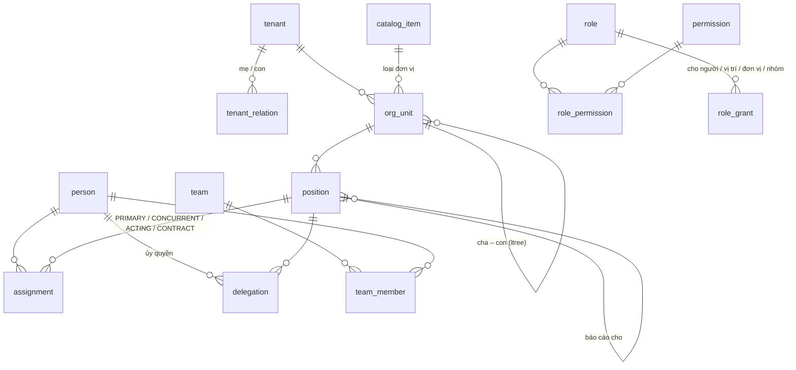
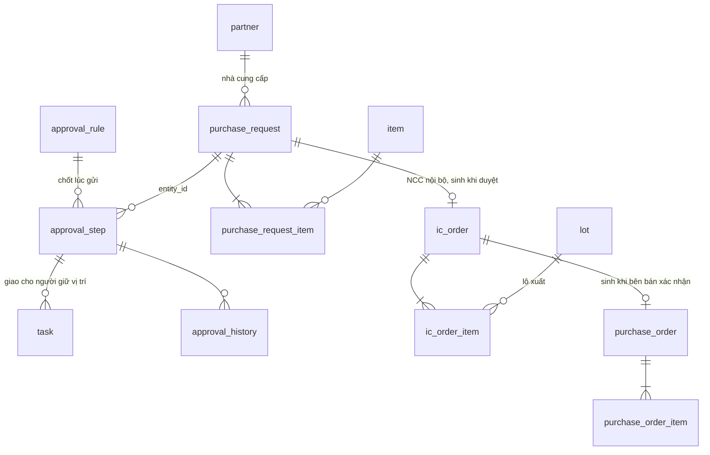

# Thiết kế cơ sở dữ liệu

Một database PostgreSQL 17 + PostGIS 3.5 tên `bms`. Migration ở `db/migrations/bms/`, chạy theo thứ tự tên tệp, tự chạy
khi `docker compose up -d` (job `migrate`, script `scripts/db/migrate.sh`). Bệnh viện X là một tenant riêng trong cùng
database, cách ly logic như mọi tenant khác (xem [ADR #15](#adr-15)).

- Kiểm thử: `make test-db` chạy mọi tệp `db/tests/bms_*.sql` (tự rollback), một tệp: `make test-db T=bms_031`; hàm dùng
  chung ở `db/tests/helpers.sql`.
- Dữ liệu demo: service `seed` (`services/seed/app/seed.py`, danh sách tài khoản ở `demo.py`) tự nạp sau migration
  ([ADR #16](#adr-16)); dữ liệu bản sao số, phả hệ, KPI nạp từ
  `services/seed/data/demo` ([ADR #50](#adr-50)).
- Tài khoản CSDL: mỗi dịch vụ một role không phải superuser (`db/roles/`): `bamboo_hasura`, `bamboo_actions`,
  `bamboo_keycloak`, `bamboo_flowable`, `bamboo_cdc` (REPLICATION, chỉ đọc), `bamboo_lakehouse`
  ([ADR #35](#adr-35)). Superuser `bms` chỉ dùng cho `migrate`, `seed` và quản trị.

## 1. Nguyên tắc

1. **Cấu trúc là dữ liệu, không phải mã.** Loại đơn vị, chức danh, vai trò, hạn mức duyệt, nhóm hàng, ngưỡng thiết bị đều
   do doanh nghiệp khai báo. Chỉ những gì nền tảng định nghĩa (danh sách quyền, trạng thái chứng từ) mới cố định.
2. **Mọi bảng nghiệp vụ có `tenant_id` và khóa kép `(tenant_id, id)`.** Khóa ngoại trỏ theo cặp này nên một bản ghi
   không thể trỏ sang tenant khác, kể cả khi ứng dụng có lỗi ([ADR #14](#adr-14)).
   Ngoại lệ có chủ đích: `core.permission` (dùng chung nền tảng), `core.tenant_relation` (nối hai tenant), mô hình thiết bị
   và siêu dữ liệu phả hệ dùng chung.
3. **Cây đơn vị không giới hạn độ sâu** bằng `ltree`: trigger tự tính `path`, chặn vòng lặp, kéo theo cây con khi chuyển.
4. **Quan hệ tổ chức có thời hạn** (`valid_period tstzrange`). Tái cấu trúc thì đóng thời hạn, không xóa.
5. **Quyền gắn với vị trí, không gắn với người**; người duyệt tìm theo cây tổ chức và loại đơn vị, không ghi cứng tên
   người ([ADR #5](#adr-5), [ADR #17](#adr-17)).
6. **Mỗi schema một miền nghiệp vụ**; Hasura track theo schema.
7. **Ràng buộc nghiệp vụ nằm trong CSDL** (CHECK, EXCLUDE, trigger): thao tác sai bị chặn ngay cả khi gọi thẳng SQL.
8. **Thay đổi quan trọng ghi vào `audit.log`** có chuỗi hash; người thực hiện lấy từ phiên Hasura.

## 2. Các schema

| Schema | Migration | Nội dung |
|---|---|---|
| `core` | 001, 002, 006, 009, 015, 021, 024, 025, 027, 039 | Tenant và quan hệ tenant, danh mục, đơn vị, vị trí, người, bổ nhiệm, quyền, vai trò, nhóm, ủy quyền, số chứng từ, tệp đính kèm và OCR, tác tử AI, lượt hỏi, công việc nạp lô |
| `mdm` | 006, 018 | Nhà cung cấp (kể cả nhà cung cấp nội bộ), vật tư |
| `wf` | 004, 005, 019, 032, 033, 040 | Quy tắc hạn mức, chuỗi duyệt, việc duyệt, lịch sử duyệt, đồng bộ Flowable, thiết kế quy trình, yêu cầu sửa quy trình, quy trình tự động và lần chạy, sự kiện nghiệp vụ |
| `proc` | 003, 006, 014, 018 | Đề nghị mua sắm và dòng hàng, đơn mua |
| `ic` | 003, 014 | Đơn hàng nội bộ và dòng hàng |
| `mfg` | 014 | Lô sản xuất |
| `hr` | 013, 029, 030 | Tiếp nhận nhân sự, nhật ký xem dữ liệu nhạy cảm, điều chuyển nội bộ và liên tập đoàn, quyết định nhân sự |
| `collab` | 008, 020, 035 | Bình luận, thông báo, tài liệu thư viện tri thức, kênh nhận thông báo |
| `audit` | 007, 017, 036, 038 | Nhật ký kiểm toán chuỗi hash, đối soát sổ cái, truy cập phòng đọc, bản neo, nhật ký sao lưu |
| `search` | 011, 025 | Hàng đợi đánh chỉ mục toàn văn và chỉ mục đoạn cho RAG |
| `cdc` | 012 | Nhịp tim giữ replication slot |
| `iot`, `meta`, `kpi` | 022, 023, 031 | Bản sao số (thiết bị, chuỗi đo, sự cố), phả hệ và chất lượng dữ liệu, KPI, ghim KPI, bản chụp KPI đã đóng băng |
| `msg` | 035, 040 | Hàng đợi tin nhắn bất đồng bộ và các lần giao |
| `obs` | 037 | Nhật ký ứng dụng tập trung |

## 3. Danh sách migration

| Migration | Nội dung |
|---|---|
| `001_to_chuc` | Tenant, quan hệ tenant, danh mục (`catalog_item`), đơn vị (`ltree`), vị trí (vị trí trưởng `is_head`, báo cáo cho `reports_to_id`), người (một tài khoản nhiều tenant, [ADR #30](#adr-30)), bổ nhiệm 4 loại `PRIMARY`/`CONCURRENT`/`ACTING`/`CONTRACT` ([ADR #29](#adr-29)); `core.position_holder`, `core.manager_position`, `core.company_of`, `core.account_tenants` |
| `002_phan_quyen` | Quyền, vai trò, nhóm, gán vai trò (cho người, vị trí, đơn vị hoặc nhóm; phạm vi `TENANT`/`SUBTREE`/`UNIT`/`SELF`), ủy quyền một phần; `core.v_permission_grant`, `core.has_permission` |
| `003_chung_tu` | `proc.purchase_request` (tư cách lập), `ic.ic_order` tối thiểu |
| `004_phe_duyet` | `wf.approval_rule`, `wf.approval_step`, `wf.task`, `wf.approval_history`; `proc.submit_purchase_request`, `wf.resolve_approval_chain`, `wf.resolve_assignee`, `wf.act`, `wf.refresh_position`, `wf.refresh_all`, `wf.v_inbox` ([ADR #28](#adr-28)) |
| `005_hasura_flowable` | Computed field `can_read` (`wf.entity_can_read`), kiểm tra phiên Hasura khi lập nháp, `wf.flow_sync` + `pg_notify` cho đồng bộ Flowable ([ADR #31](#adr-31)) |
| `006_mua_sam` | `mdm.partner`, `mdm.item`; số chứng từ `core.next_doc_no` (bảng đếm `core.doc_sequence`); dòng hàng `proc.purchase_request_item` (tổng tiền tự tính, khóa sau khi gửi); `proc.cancel_purchase_request` |
| `007_kiem_toan` | `audit.log` nối chuỗi hash theo tenant, chỉ ghi thêm; `audit.enable`, `audit.verify_chain`, `audit.v_reader` ([ADR #33](#adr-33)) |
| `008_cong_tac` | `collab.comment` (nhắc tên, trả lời, xóa mềm), `collab.notification` sinh bằng trigger, `collab.mark_notifications_read` |
| `009_tep_dinh_kem` | `core.attachment` (`PENDING` → `CLEAN`/`INFECTED`/`REJECTED`), quyền xem theo chứng từ gốc ([ADR #26](#adr-26)) |
| `010_vai_tro` | `audit.log_change` chạy `SECURITY DEFINER`, thu quyền gọi trực tiếp |
| `011_tim_kiem` | `search.pending`: hàng đợi đánh chỉ mục, trigger trên đề nghị, dòng hàng, tệp, tên nhà cung cấp/người/đơn vị ([ADR #36](#adr-36)) |
| `012_cdc` | `cdc.heartbeat`, publication `bms_cdc` ([ADR #38](#adr-38)) |
| `013_nhan_su` | `hr.onboarding_request` (số `TN-…`), dữ liệu nhạy cảm lưu bản mã hóa và bản che, `hr.private_access` ghi mỗi lần xem bản đầy đủ; duyệt xong tạo người (mã `NV-…`) và bổ nhiệm ([ADR #41](#adr-41)) |
| `014_don_hang_noi_bo` | `mfg.lot`, `ic.ic_order_item`, `proc.purchase_order` (`PO-…`) và dòng hàng; xác nhận / từ chối / hủy đơn nội bộ; thêm `mfg` vào CDC ([ADR #42](#adr-42)) |
| `015_quan_tri` | `core.v_admin` (người có quyền quản trị tổ chức, phân quyền, dữ liệu chủ); kiểm toán danh mục ([ADR #44](#adr-44)) |
| `016_du_lieu_lakehouse` | Quyền `data.lakehouse.read` |
| `017_so_cai` | `audit.ledger_check` (lần đối soát tệp), `audit.archive_access` (truy cập phòng đọc), niêm phong tệp ([ADR #46](#adr-46)) |
| `018_ncc_de_xuat_han_muc` | Nhà cung cấp đề xuất (tên, mã số thuế) trên đề nghị, `mdm.adopt_proposed_partner`; hạn mức Ổ đĩa (`core.storage_used`) |
| `019_thiet_ke_quy_trinh` | `wf.process_model`, `wf.process_version`, `wf.sandbox_run` ([ADR #47](#adr-47)) |
| `020_thu_vien_tri_thuc` | `collab.kb_document` (đề xuất tài liệu số `TL-…` đi chuỗi duyệt, xuất bản, ngừng hiệu lực) ([ADR #48](#adr-48)) |
| `021_dieu_hanh` | Tỉnh, tọa độ cơ sở; quyền `ops.group.read`; `core.child_tenants` ([ADR #49](#adr-49)) |
| `022_ban_sao_so_pha_he_kpi` | Schema `iot`, `meta`, `kpi`; `iot.acknowledge`, giới hạn 6 ghim KPI ([ADR #50](#adr-50)) |
| `023_kpi_tu_du_lieu` | KPI tính từ dữ liệu nghiệp vụ (`kpi.on_time_rate`, `kpi.refresh`) |
| `024_tac_tu_ai` | `core.ai_agent`, quyền `core.ai.manage`, `core.v_ai_admin` ([ADR #51](#adr-51)) |
| `025_luot_hoi_ai` | `core.ai_question`, `search.pending_chunk` |
| `026_dong_suy_nghi_ai` | Dòng suy nghĩ của mô hình trong lượt hỏi |
| `027_ocr_tep_dinh_kem` | `core.attachment_ocr` và hàng đợi OCR ([ADR #52](#adr-52)) |
| `028_do_toc_do_ai` | `first_token_at`, `cold_start` của lượt hỏi |
| `029_dieu_chuyen_nhan_su` | `hr.transfer_request` (`DC-…`); điều chuyển liên tập đoàn `hr.transfer_out` (`DL-…`), `hr.transfer_in`, `hr.transfer_group`; chặn sửa trực tiếp bổ nhiệm giữ chính (`core.assignment_transfer_guard`) |
| `030_quyet_dinh_nhan_su` | `hr.personnel_decision` (`QD-…`), `hr.issue_personnel_decision` |
| `031_dong_bang_kpi` | `kpi.snapshot` chỉ ghi thêm, `kpi.freeze`, `kpi.verify_snapshots` |
| `032_giam_sat_quy_trinh` | Đơn vị sở hữu và đối tượng phát hành của quy trình, `wf.process_change_request`, `wf.process_access`, thông báo khi phát hành |
| `033_tu_dong_hoa_quy_trinh` | `wf.process_automation`, `wf.automation_run` |
| `034_quet_tep` | `scan_engines`, `scan_report` của tệp; tệp `CLEAN` phải có công cụ đã quét; tệp cũ chưa quét đánh dấu `unscanned` |
| `035_kenh_thong_bao_hang_doi` | Schema `msg`: `msg.queue`, `msg.attempt`; `collab.notification_pref`; mỗi thông báo sinh tin cho kênh người nhận đã bật |
| `036_neo_chuoi_kiem_toan` | `audit.anchor`, `audit.check_anchors` |
| `037_nhat_ky_tap_trung` | `obs.log_event`, `obs.purge` |
| `038_nhat_ky_sao_luu` | `audit.backup_run` (`BACKUP`/`DRILL`); sửa trigger `org_unit_after_move` để bản sao lưu khôi phục được |
| `039_nap_du_lieu_theo_lo` | `core.ingest_job` |
| `040_kich_ban_tu_dong` | Sự kiện nghiệp vụ `event.*` qua `msg.queue` (`wf.emit_event`), mã webhook lưu dạng băm, quy trình tự động đăng ký theo sự kiện |
| `041_kpi_vao_lakehouse` | Thêm `kpi.snapshot` vào publication CDC |
| `046_chi_muc_toan_van` | Chỉ mục toàn văn theo từng phần; tệp hồ sơ tiếp nhận nhân sự tìm theo tên tệp (`search.attachment_searchable`, `attachment_name_only`); đánh dấu lại mọi tệp |

Quy ước số chứng từ (`core.next_doc_no(tenant, tiền tố)`, theo tenant, tiền tố và năm giờ Việt Nam, không nhảy số):
`PR` đề nghị mua sắm, `IC` đơn hàng nội bộ, `PO` đơn mua, `TN` tiếp nhận nhân sự, `NV` mã nhân viên, `DC` điều chuyển nội
bộ, `DL` điều chuyển liên tập đoàn, `QD` quyết định nhân sự, `TL` đề xuất tài liệu thư viện.

## 4. Sơ đồ quan hệ chính

### Tổ chức và phân quyền

### Phê duyệt, mua sắm, giao dịch nội bộ

`wf.approval_step`, `wf.task`, `wf.approval_history` dùng chung cho mọi loại chứng từ (`entity_type`, `entity_id`): đề nghị
mua sắm, tiếp nhận nhân sự, điều chuyển, đề xuất tài liệu thư viện.

## 5. Các cơ chế quan trọng

### 5.1. Bổ nhiệm, kiêm nhiệm, ủy quyền

- `core.assignment.assignment_type`: `PRIMARY` (mỗi người một vị trí chính tại một thời điểm, ràng buộc `EXCLUDE`),
  `CONCURRENT`, `ACTING` (quyền trưởng khi vị trí trống), `CONTRACT` (bắt buộc số hợp đồng và ngày kết thúc, không bao giờ
  là người duyệt). Hiệu lực theo ngày.
- `core.delegation`: người giữ vị trí tạm giao một phần quyền (danh sách quyền) cho người cùng công ty; trigger chặn ủy quyền
  vị trí mà người ủy quyền không giữ, và không nhận ủy quyền qua bổ nhiệm hợp đồng.
- `core.v_permission_grant` gộp quyền của từng người kèm thời hạn hiệu lực, từ bổ nhiệm vào vị trí, vai trò gán cho
  đơn vị, nhóm, ủy quyền (lọc theo danh sách quyền) và gán thẳng cho người (bắt buộc có ngày kết thúc).
- `core.has_permission(person, quyền, đơn vị)` kiểm phạm vi `TENANT` / `SUBTREE` / `UNIT`; `SELF` kiểm ở tầng nghiệp vụ.
- Người đã có bổ nhiệm giữ chính chỉ đổi vị trí chính qua đề nghị điều chuyển đã duyệt hoặc quyết định nhân sự
  (`core.assignment_transfer_guard`).

### 5.2. Chuỗi duyệt

`wf.approval_rule`: mỗi dòng là một bước, áp dụng khi `min_amount <= số tiền < max_amount`, theo `process_code`.

- `approver_unit_type_id`: loại đơn vị của cấp duyệt; `NULL` nghĩa là quản lý trực tiếp của vị trí người lập.
- `scope_unit_id`, `category_code`: quy tắc có phạm vi đơn vị sâu hơn hoặc theo nhóm hàng thắng quy tắc chung.
- `wf.resolve_approval_chain(tenant, process, vị trí lập, số tiền, nhóm hàng)` trả danh sách **vị trí** duyệt; chuỗi chốt
  lúc gửi duyệt.
- `wf.resolve_assignee(vị trí, người lập, người xung đột)` tìm **người** khi đến lượt bước: vị trí trống
  (`VACANT`), người giữ theo hợp đồng (`CONTRACT`), trùng người lập (`REQUESTER`) hoặc đã đứng phía bên kia của giao dịch
  nội bộ (`CONFLICT`) thì đẩy lên vị trí quản lý kế tiếp, lý do ghi vào lịch sử
  ([ADR #28](#adr-28)).
- Bổ nhiệm thay đổi thì trigger `wf.assignment_after_change` gọi `wf.refresh_position`: việc đang chờ chuyển sang người giữ
  mới. `wf.refresh_all()` xử lý bổ nhiệm hết hạn theo lịch.
- `wf.v_inbox`: hộp việc của từng người, gồm cả việc nhận qua ủy quyền (`via_delegation`).
- Sự kiện lịch sử: `SUBMITTED`, `ASSIGNED`, `ESCALATED`, `MERGED`, `TRANSFERRED`, `APPROVED`, `REJECTED`, `RETURNED`,
  `CANCELLED`, `OWNER_TRANSFERRED`, `COMPLETED`.

Dữ liệu mẫu: dưới 50 triệu quản lý trực tiếp; 50 đến dưới 500 triệu giám đốc công ty; từ 500 triệu thêm Tổng giám đốc; đơn vị
trực thuộc tập đoàn từ 50 triệu lên thẳng Tổng giám đốc; Bệnh viện X có quy tắc riêng, nhóm thiết bị y tế luôn hai bước
([Kịch bản nghiệp vụ](../tong-quan/02-kich-ban-nghiep-vu.md)).

### 5.3. Chứng từ mua sắm và giao dịch nội bộ

- Tổng tiền đầu phiếu tự tính từ dòng hàng; dòng hàng chỉ sửa được khi đề nghị còn nháp hoặc bị trả về.
- Người lập hủy được khi chưa duyệt xong (`proc.cancel_purchase_request`). Nhà cung cấp chưa có trong danh mục thì ghi
  tên và mã số thuế đề xuất; người có `mdm.manage` đưa vào danh mục (`mdm.adopt_proposed_partner`).
- Đề nghị chọn nhà cung cấp nội bộ: duyệt xong thì `ic.create_from_request` sinh `ic.ic_order`. Bên bán xác nhận kèm lô
  (`ic.confirm_order`; lô phải của công ty bán, đúng mặt hàng, `RELEASED`, không xuất quá số lượng) thì
  `proc.issue_purchase_order` sinh đơn mua; bên bán từ chối hoặc người đặt hủy khi còn `PENDING`, bắt buộc lý do.
- Chưa có: nhận hàng, hóa đơn, thanh toán, đối trừ công nợ nội bộ, phả hệ lô (lô cha – lô con).

### 5.4. Nhân sự

- **Tiếp nhận** (013): chuỗi duyệt tính từ vị trí được bổ nhiệm, không từ tư cách lập. CCCD, số tài khoản, địa chỉ lưu bản mã
  hóa bằng OpenBao transit và bản che; chỉ phòng nhân sự xem bản đầy đủ, mỗi lần xem ghi `hr.private_access`.
- **Điều chuyển** (029): người lập là chính nhân viên, quản lý trực tiếp hoặc người có `hr.transfer.create`; ngày chuyển
  cách ngày gửi ít nhất 14 ngày; trưởng đơn vị tiếp nhận chọn vị trí rồi trưởng phòng nhân sự của công ty chung gần nhất duyệt.
  Liên tập đoàn gồm ba chứng từ liên kết, mỗi chứng từ nằm ở tenant của người duyệt.
- **Quyết định nhân sự** (030): lãnh đạo cao nhất của tenant ban hành bổ nhiệm, điều chuyển, miễn nhiệm, có hiệu lực ngay,
  không qua chuỗi duyệt; in PDF từ mẫu.

### 5.5. Nhật ký kiểm toán, sổ cái và neo

- Trigger `audit.log_change()` (gắn bằng `CALL audit.enable('schema.bang')`) ghi dữ liệu cũ/mới, cột thay đổi, người và role.
- Mỗi dòng có `seq` liên tục theo tenant và `hash = sha256(prev_hash || nội dung)` (`audit.compute_hash`). `audit.log` chỉ ghi
  thêm (`audit.log_append_only`); `audit.verify_chain(tenant)` trả dòng hỏng
  ([ADR #33](#adr-33)).
- Sổ cái tệp (017): đối soát SHA-256 của tệp với chuỗi kiểm toán, phòng đọc chỉ đọc có nhật ký truy cập
  ([ADR #46](#adr-46)).
- Neo (036): đầu chuỗi được ký Ed25519 bằng OpenBao và công bố ra ngoài CSDL; nội dung đã ký bất biến;
  `audit.check_anchors` phát hiện chuỗi bị cắt hoặc viết lại.
- `audit.backup_run` (038) ghi từng lần sao lưu và diễn tập khôi phục, chỉ thêm.
- Nhật ký trả cho giao diện luôn là bản che ([ADR #43](#adr-43)).

### 5.6. Cộng tác, thông báo và hàng đợi tin nhắn

- `collab.comment`: bình luận trên chứng từ bất kỳ (`entity_type`, `entity_id`), trả lời theo luồng, nhắc tên cùng tenant,
  xóa mềm. Thêm loại chứng từ mới: bổ sung nhánh vào `collab.entity_owner`, `collab.entity_label`, `collab.entity_tenant`.
- `collab.notification` sinh bằng trigger (việc được giao, chứng từ được duyệt / từ chối / trả về / hủy, bình luận, nhắc tên,
  đơn nội bộ, quy trình phát hành, tác vụ tự động...).
- `collab.notification_pref` (035): người dùng bật kênh email, SMS, webhook theo loại thông báo; `collab.notification_fanout`
  sinh tin vào `msg.queue`.
- `msg.queue`: mỗi tin có chủ đề, nội dung, mã băm nội dung, khóa chống trùng; trạng thái `PENDING` → `LEASED` →
  `DELIVERED` hoặc `DEAD`; thuê tin (`msg.lease`), thử lại lùi dần (`msg.fail`, `msg.retry`), biên nhận có chữ ký khi giao
  xong (`msg.complete`). `msg.attempt` ghi từng lần giao. Sự kiện nghiệp vụ `event.*` (040) đi chung hàng đợi này.

### 5.7. Tệp đính kèm, tìm kiếm, OCR

- `core.attachment`: chỉ đi tiếp từ `PENDING`; `CLEAN` phải có `scan_engines` (034); tệp của chứng từ đã có kết quả được giữ
  làm chứng cứ. Loại chứng từ đính kèm được: đề nghị mua sắm, tiếp nhận nhân sự, đề xuất tài liệu thư viện.
- `search.pending` / `search.pending_chunk`: trigger đánh dấu bản ghi cần đánh chỉ mục lại; `search-sync` xử lý có thử lại.
- `core.attachment_ocr` (027): việc OCR từng tệp (`PENDING`/`RUNNING`/`DONE`/`ERROR`/`SKIPPED`); văn bản OCR chỉ dùng để tìm,
  không đi vào CDC.

### 5.8. Quy trình: thiết kế, giám sát, chạy tự động

- `wf.process_model` / `wf.process_version`: BPMN XML là nguồn sự thật; phát hành tạo phiên bản bất biến
  ([ADR #47](#adr-47)). Quy trình thuộc một đơn vị sở hữu; khi phát hành chọn đối
  tượng `UNIT` / `COMPANY` / `GROUP` để thông báo và cho xem (`wf.process_access`).
- `wf.process_change_request`: quản lý, giám đốc yêu cầu sửa quy trình.
- `wf.process_automation` / `wf.automation_run` (033, 040): phiên bản đã phát hành chỉ gồm tác vụ tự động, cổng, hẹn giờ thì
  bật chạy tự động trên Flowable; khởi chạy bằng hẹn giờ, tay, webhook (mã lưu SHA-256) hoặc sự kiện nghiệp vụ.

### 5.9. Dữ liệu số: KPI, bản sao số, phả hệ

- `kpi.definition`, `kpi.value` (tính lại từ dữ liệu nguồn, `kpi.refresh`), `kpi.pin` (tối đa 6 ghim mỗi người).
- `kpi.snapshot` (031): giá trị KPI của kỳ đã kết thúc chụp một lần bằng `kpi.freeze`, không sửa không xóa
  (`kpi.snapshot_guard`), kiểm bằng `kpi.verify_snapshots`; đi vào Lakehouse qua CDC (041).
- `iot.*`: mô hình thiết bị, cơ sở, thực thể, chuỗi đo, sự cố vượt ngưỡng; `iot.acknowledge` ghi nhận sự cố.
- `meta.*`: nút / cạnh phả hệ, kiểm tra chất lượng, lần chạy pipeline, sự cố dữ liệu người dùng báo.
- Dữ liệu `iot` và `meta` hiện nạp từ tệp demo, chưa thu từ cảm biến hay pipeline thật
  ([ADR #50](#adr-50)).

### 5.10. Trí tuệ số

- `core.ai_agent`: tác tử của tenant (mô hình Ollama, trạng thái, guardrail `scope_guard`/`pii_guard`/`prompt_guard`/`think`,
  công cụ `search_docs`/`cite`); ghi qua Action, cần `core.ai.manage`.
- `core.ai_question`: một lượt hỏi (`queued` → `running` → `done` / `refused` / `error`), câu trả lời ghi dần, trích dẫn,
  token, `first_token_at`, `cold_start`; người dùng chỉ đọc lượt hỏi của chính mình
  ([ADR #51](#adr-51), [ADR #52](#adr-52)).

### 5.11. Vận hành: nhật ký tập trung, nạp lô

- `obs.log_event` (037): log của dịch vụ và container (qua Vector) kèm `trace_id` = `X-Request-Id` của cổng API, đã che dữ liệu
  cá nhân; `obs.purge` xóa theo thời hạn lưu.
- `core.ingest_job` (039): mỗi lần nạp NDJSON/CSV là một công việc có khóa chống nạp trùng, tiến độ, số dòng nhận / từ chối,
  lỗi từng dòng; có chạy thử và chế độ nguyên tử.

### 5.12. CDC

PostgreSQL chạy `wal_level=logical`. Publication `bms_cdc` gồm mọi bảng (kể cả bảng tạo sau) trong `core, mdm, wf, proc, ic,
mfg, collab, cdc` và bảng `kpi.snapshot`; không gồm `audit`, `search`, `hr`, `iot`, `meta`, `msg`, `obs`. Debezium bỏ cột
`core.attachment_ocr.page_texts`. Role `bamboo_cdc` (REPLICATION, chỉ đọc) dành cho Debezium; `cdc.heartbeat` giữ slot khi
không có thay đổi. Kafka, Debezium, Lakehouse: [Dịch vụ nền tảng mục 7–9](06-dich-vu-nen-tang.md).

## 6. Tích hợp

- **Keycloak chỉ xác thực** ([ADR #6](#adr-6),
  [ADR #32](#adr-32)): token chỉ cần `sub`; `core.person.idp_subject` = `sub`. Id
  tài khoản demo và tenant sinh bằng `uuid5` để khớp giữa realm và CSDL
  ([ADR #23](#adr-23)).
- **Hasura xác thực bằng webhook** `GET /auth/hasura` của `actions`: kiểm token bằng JWKS của Keycloak, đọc tenant ở header
  `x-bamboo-tenant`, tra `core.account_tenants(sub)`. Chưa chọn tenant: role `account` (chỉ `my_tenants`); đã chọn: role
  `user` với `x-hasura-user-id` = `person.id` trong tenant; `platform_admin` khi có realm role tương ứng.
- **Metadata Hasura** sinh bằng `services/actions/app/hasura_metadata.py` vào `platform/hasura/metadata.json` (`make
  hasura-metadata`), job `bootstrap` nạp khi khởi động
  ([ADR #24](#adr-24)). Hiện track 62 bảng/view (61 có quyền select lọc theo tenant
  và computed field `can_read`) và 99 Action. Ghi trực tiếp qua Hasura chỉ cho các thao tác đơn giản trên bản ghi của chính
  mình (nháp, dòng hàng, bình luận, đánh dấu đã đọc); thao tác nghiệp vụ đi qua Hasura Action.
- **Flowable** không giữ người duyệt: CSDL là nguồn sự thật của chuỗi duyệt, `flow-sync` phản chiếu sang Flowable
  ([ADR #31](#adr-31)).

## 7. Quy ước khi thêm migration

1. Tên tệp `NNN_mo_ta.sql` trong `db/migrations/bms/`. Không sửa migration đã đẩy lên Git; tạo tệp mới.
2. Mỗi tệp chạy trong một giao dịch; lỗi thì không để lại gì.
3. Bảng mới: có `tenant_id`, khóa kép `(tenant_id, id)`, khóa ngoại theo cặp, index cho khóa ngoại; gọi `audit.enable` nếu cần
   kiểm toán. `db/roles/grants.sql` tự cấp quyền cho mọi schema sau mỗi lần migrate.
4. Hàm truy cập bảng: ghi đủ tên schema hoặc đặt `SET search_path`, vì Hasura gọi với `search_path` mặc định.
5. Lỗi nghiệp vụ trả về giao diện dùng `ERRCODE = 'data_exception'` để Hasura chuyển nguyên thông báo.
6. Thêm kiểm thử vào `db/tests/`, chạy `make test-db`; đổi bảng thì chạy `make hasura-metadata` và `make trino-sql`.
