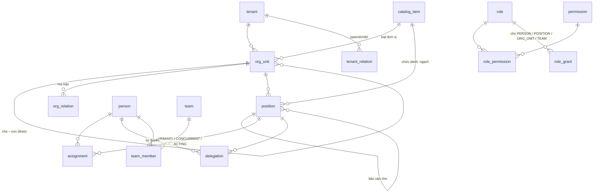
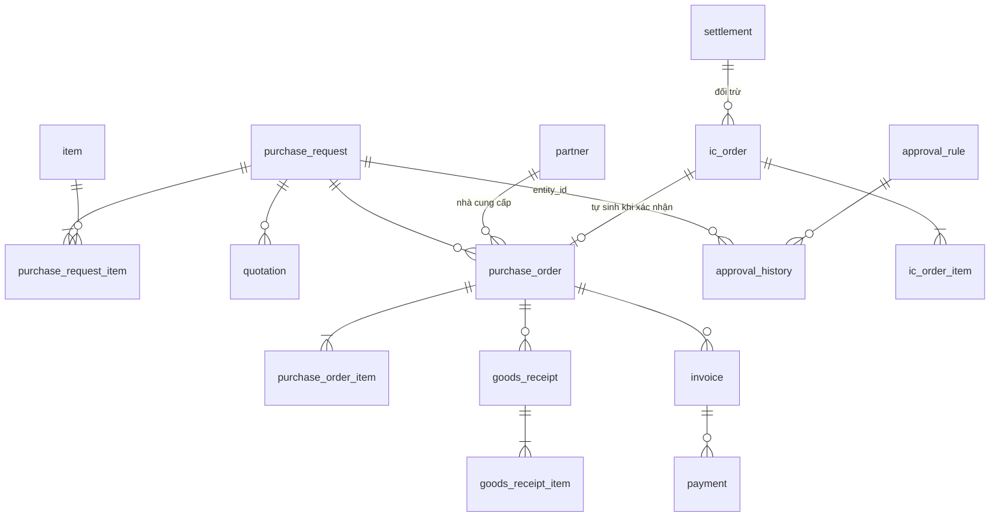
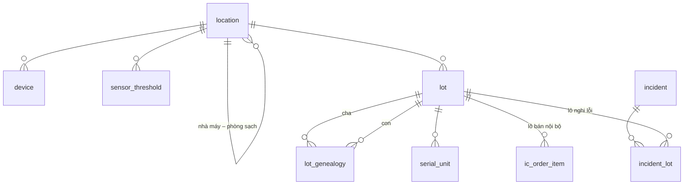

# Thiết kế cơ sở dữ liệu

Hai database PostgreSQL 17 + PostGIS 3.5, migration tự chạy khi `docker compose up -d`:

| Database | Thư mục migration | Nội dung |
|---|---|---|
| `bms` | `db/migrations/bms/` | Tổ chức, phân quyền, dữ liệu chủ, mua sắm, giao dịch nội bộ, sản xuất, kết luận khám sức khỏe, nhật ký |
| `bms_hospital` | `db/migrations/hospital/` | Hồ sơ bệnh án (EMR) của Bệnh viện X, cách ly cứng ([ADR #15](#adr-15)) |

Kiểm thử: `make test-db` chạy mọi file `db/tests/bms_*.sql` và `hospital_*.sql` (tự rollback); hàm tiện ích dùng chung ở `db/tests/helpers.sql`.
Dữ liệu mẫu: `scripts/seed/seed.py`, tự nạp sau migration ([ADR #16](#adr-16)).

## 1. Nguyên tắc

1. **Cấu trúc là dữ liệu, không phải mã nguồn.** Loại đơn vị, chức danh, ngạch bậc, vai trò, hạn mức duyệt, ngưỡng cảm biến đều do doanh nghiệp khai báo. Chỉ những gì nền tảng định nghĩa (danh sách quyền, trạng thái chứng từ) mới cố định.
2. **Mọi bảng nghiệp vụ có `tenant_id`, khóa ngoại kiểm tra cùng tenant.** Dùng khóa kép `(tenant_id, id)`: một bản ghi không thể trỏ sang bản ghi của tenant khác, kể cả khi ứng dụng có lỗi ([ADR #14](#adr-14)). Ngoại lệ có chủ đích: `core.permission` (dùng chung toàn nền tảng), `core.tenant_relation` (nối hai tenant), `wf.status_transition`.
3. **Cây không giới hạn độ sâu** bằng `ltree`; trigger tự tính `path`, chặn vòng lặp, kéo theo cây con khi tái cấu trúc.
4. **Mọi quan hệ tổ chức có thời hạn** (`valid_period tstzrange`). Tái cấu trúc thì đóng thời hạn, không xóa.
5. **Quyền gắn với vị trí, không gắn với người.** Luân chuyển nhân sự thì quyền tự đi theo vị trí mới.
6. **Người duyệt tìm theo cây tổ chức và loại đơn vị**, không viết cứng tên người, không đếm số cấp ([ADR #17](#adr-17)).
7. **Mỗi schema một miền nghiệp vụ** ([ADR #14](#adr-14)), Hasura track theo schema.
8. **Mọi bảng có `created_at/by`, `updated_at/by`**; người thực hiện lấy từ session Hasura (`x-hasura-user-id`). Mọi thay đổi ghi vào `audit.log` có chuỗi hash.

## 2. Các schema

| Schema | Migration | Vai trò |
|---|---|---|
| `core` | 001, 002, 009 | Tenant, danh mục tự định nghĩa, cây tổ chức, nhân sự, vị trí, bổ nhiệm, nhóm, vai trò, phân quyền, ủy quyền, địa điểm, tệp đính kèm, số chứng từ |
| `mdm` | 003 | Dữ liệu chủ: đơn vị tính, nhóm hàng, vật tư/hàng hóa, đối tác, ngân sách |
| `wf` | 004 | Chuyển trạng thái hợp lệ, quy tắc hạn mức duyệt, lịch sử phê duyệt |
| `proc` | 004 | Mua sắm – thanh toán: đề nghị → báo giá → đơn mua → nhận hàng → hóa đơn → thanh toán |
| `ic` | 005 | Đơn hàng nội bộ, tự sinh đơn mua, đối trừ công nợ |
| `mfg` | 006 | Thiết bị cảm biến, ngưỡng, lô sản xuất, phả hệ lô, serial, sự cố |
| `hr` | 007 | Kết luận khám sức khỏe (chỉ đủ/không đủ) |
| `audit` | 008 | Nhật ký thay đổi có chuỗi hash, nhật ký thao tác cho Refine |
| `collab` (+ `wf.task`) | 010 | Bình luận trên chứng từ, thông báo, hộp việc cần duyệt |
| `emr` (DB riêng) | hospital/001–002 | Bệnh nhân, lượt khám, chỉ số, chẩn đoán, giường, khám sức khỏe |

## 3. Sơ đồ quan hệ chính

### Tổ chức và phân quyền

### Mua sắm – thanh toán

### Sản xuất và truy xuất

## 4. Các cơ chế quan trọng

### 4.1. Bổ nhiệm, kiêm nhiệm, ủy quyền

- `assignment.assignment_type`: `PRIMARY` (mỗi người một vị trí chính tại một thời điểm, ràng buộc `EXCLUDE`), `CONCURRENT` (kiêm nhiệm), `ACTING` (quyền trưởng khi vị trí trống).
- `delegation`: người nhận tạm mang quyền của một vị trí. Trigger chặn ủy quyền vị trí mà người ủy quyền không giữ.
- `v_effective_permission` gộp quyền từ: vị trí chính, kiêm nhiệm, quyền, ủy quyền, đơn vị, nhóm.
- `has_permission(person, permission, unit)` kiểm tra phạm vi `TENANT` / `SUBTREE` / `UNIT`; `SELF` kiểm tra ở tầng nghiệp vụ (người tạo bản ghi).

### 4.2. Hạn mức duyệt (nguồn dữ liệu cho DMN)

`wf.approval_rule`: mỗi dòng là một bước duyệt, áp dụng khi `min_amount <= số tiền < max_amount`.

- `approver_unit_type`: mã loại đơn vị của cấp duyệt (`CONG_TY`, `TAP_DOAN`, `BENH_VIEN`...). `NULL` nghĩa là quản lý trực tiếp.
- `scope_unit_id`, `category_id`: quy tắc có phạm vi sâu hơn hoặc theo nhóm hàng thay thế quy tắc chung.
- Một người duyệt theo khoảng tiền: các khoảng không chồng nhau. Duyệt nhiều cấp: nhiều dòng cùng khớp, xếp theo `step_order`.

Hàm:

| Hàm | Dùng để |
|---|---|
| `core.resolve_approver(unit, unit_type, exclude_person)` | Trưởng đơn vị gần nhất thuộc loại yêu cầu; người lập trùng người duyệt thì lên cấp trên; ưu tiên PRIMARY rồi ACTING |
| `wf.resolve_approval_chain(process, unit, amount, category, requester)` | Chuỗi người duyệt cho một yêu cầu bất kỳ |
| `wf.resolve_pr_approvers(request_id)` | Chuỗi người duyệt cho một đề nghị mua sắm (Hasura Action / Flowable gọi) |

Dữ liệu mẫu cấu hình đúng ví dụ ở [Kịch bản nghiệp vụ](../tong-quan/02-kich-ban-nghiep-vu.md): dưới 50 triệu – quản lý trực tiếp; 50 đến dưới 500 triệu – giám đốc công ty; từ 500 triệu – Tổng giám đốc tập đoàn. Bệnh viện có thêm quy tắc thiết bị y tế duyệt 2 cấp.

### 4.3. Chứng từ

- Số chứng từ `PR-2026-000001` sinh bằng `core.next_doc_no()` theo tenant, loại, năm.
- `wf.status_transition` + trigger `wf.check_transition()` chặn chuyển trạng thái sai quy trình.
- Tổng tiền đầu phiếu tự tính từ dòng hàng (`core.recalc_header_total`).
- Dòng hàng của đề nghị bị khóa sau khi gửi duyệt.
- View phân tích: `proc.v_po_match` (đối chiếu đặt – nhận – hóa đơn – thanh toán), `proc.v_budget_usage` (ngân sách đã cam kết, đã chi), `proc.v_split_suspect` (nghi chia nhỏ đơn để né hạn mức – dùng cho cảnh báo [I]).

### 4.4. Giao dịch nội bộ

- Mỗi công ty con có một `mdm.partner` với `internal_unit_id` trỏ về chính công ty đó.
- Khi `ic.ic_order` chuyển sang `CONFIRMED`, trigger tự sinh `proc.purchase_order` cho bên mua (nhà cung cấp là đối tác nội bộ của bên bán).
- `ic.settle(tenant, unit_a, unit_b, 'YYYY-MM')` đối trừ công nợ hai chiều, tạo `ic.settlement` và chuyển các đơn sang `SETTLED`. Báo cáo hợp nhất loại trừ các giao dịch này.

### 4.5. Truy xuất lô

- `mfg.lot_genealogy`: lô cha được dùng để tạo lô con (wafer → chip → điện thoại).
- `mfg.trace_forward(lot)`, `mfg.trace_backward(lot)`, `mfg.affected_serials(lot)`: từ một lô wafer lỗi tìm ra các serial điện thoại đã bán.
- `mfg.flag_lots_for_incident(incident)`: gắn cờ nghi lỗi cho các lô đang ở địa điểm xảy ra sự cố.
- Chuỗi số đo cảm biến **không** lưu ở PostgreSQL: nằm ở Orion-LD và Lakehouse. PostgreSQL chỉ giữ thiết bị, ngưỡng và sự cố.

### 4.6. Cách ly dữ liệu bệnh viện

- Bệnh án nằm ở database `bms_hospital`, không có bảng nào trong `bms` chứa dữ liệu y tế (kiểm thử xác nhận).
- Ra ngoài chỉ qua view, mỗi view một role:
  - `hospital_analytics` → `emr.v_kpi_daily`, `emr.v_bed_occupancy`: số liệu tổng hợp, không định danh.
  - `hospital_hr_export` → `emr.v_health_check_conclusion`: chỉ mã nhân viên bên doanh nghiệp và kết luận đủ/không đủ.
- Phía doanh nghiệp chỉ lưu `hr.health_check_conclusion`.

### 4.7. Nhật ký kiểm toán

- Trigger `audit.log_change()` gắn vào mọi bảng nghiệp vụ, ghi dữ liệu cũ/mới, danh sách cột thay đổi, người thực hiện.
- Mỗi dòng có `hash = sha256(prev_hash || nội dung)`. `audit.verify_chain()` trả về dòng bị sửa; `audit.log` chỉ cho ghi thêm (trừ cột `sealed_at` khi đẩy sang immudb).
- `audit.activity` phục vụ `auditLogProvider` của Refine.
- Bảng mới: gọi `CALL core.enable_tracking('schema.bang')` và `CALL audit.enable('schema.bang')` trong migration.

### 4.8. Cộng tác: bình luận, thông báo, hộp việc

- `collab.comment`: bình luận gắn với chứng từ bất kỳ (`entity_type`, `entity_id`), trả lời theo luồng (`parent_id`), nhắc tên (`mentions`, kiểm tra cùng tenant), xóa mềm.
- `wf.task`: bản sao task của Flowable để giao diện đọc qua Hasura (subscription realtime) mà không gọi thẳng Flowable. Flowable vẫn là nguồn sự thật; Hasura Action ghi/cập nhật bảng này khi tạo hoặc hoàn thành task ([ADR #20](#adr-20)).
- `wf.v_inbox`: hộp việc của từng người, **gồm cả việc nhận qua ủy quyền** (`via_delegation`).
- `collab.notification` sinh tự động bằng trigger, không cần ứng dụng gọi:

| Sự kiện | Người nhận |
|---|---|
| Bình luận | Người được nhắc tên (`MENTION`), chủ chứng từ (`COMMENT`) |
| Task được giao / giao lại | Người được giao và người đang nhận ủy quyền của họ (`TASK_ASSIGNED`) |
| Đề nghị được duyệt / từ chối / trả về | Người lập đề nghị, kèm người duyệt (`REQUEST_*`) |
| Sự cố hiện trường | Mọi người có quyền `mfg.incident.manage` trên đơn vị quản lý địa điểm (`INCIDENT`) |

- Mỗi thông báo mới phát `pg_notify('bms_notification', …)` cho dịch vụ realtime.
- `collab.mark_notifications_read(hasura_session, ids)`: Hasura track làm mutation, chỉ đánh dấu thông báo của người gọi.
- Thêm loại chứng từ mới: bổ sung nhánh vào `collab.entity_owner()` và `collab.entity_label()`.

### 4.9. CDC và hiệu năng

**CDC (migration 011).** PostgreSQL chạy `wal_level=logical`. Publication `bms_cdc` gồm mọi bảng (kể cả bảng tạo sau) trong `core, mdm, wf, proc, ic, mfg, hr, collab`; không gồm `audit` và `public`. Bảng tổ chức đặt `REPLICA IDENTITY FULL` để Lakehouse có ảnh trước khi sửa. Role `bms_cdc` (REPLICATION, chỉ đọc) dành cho Debezium, cấp mật khẩu khi triển khai từ OpenBao. `bms_hospital` không có publication ([ADR #22](#adr-22)).

**Bảng quyền tính sẵn (migration 012, [ADR #21](#adr-21)).**

- `core.v_permission_grant`: quyền của từng người **kèm thời hạn hiệu lực** (giao của thời hạn bổ nhiệm, ủy quyền, thành viên nhóm và gán vai trò).
- `core.mv_permission_grant`: bản tính sẵn. Vì lưu cả thời hạn nên chỉ cần làm mới khi dữ liệu phân quyền đổi, không phải làm mới theo giờ (ủy quyền từ ngày 20 tự có hiệu lực vào ngày 20).
- Trigger trên 8 bảng phân quyền: trước câu lệnh bật cờ `bms.permission_dirty` của giao dịch; lúc commit làm mới bản tính sẵn đúng một lần (`CONCURRENTLY`, không chặn người đọc).
- `core.v_effective_permission` giữ nguyên cột: khi cờ bật (giao dịch đang sửa phân quyền) đọc trực tiếp nên luôn đúng; bình thường đọc bản tính sẵn.
- Đo trên dữ liệu mẫu, 7.306 lần `has_permission`: đọc trực tiếp 3.747 ms → bản tính sẵn 484 ms (nhanh 7,7 lần), kết quả giống hệt.

**Index khóa ngoại.** Mọi khóa ngoại nghiệp vụ có index. `core.v_unindexed_foreign_key` liệt kê khóa ngoại thiếu index; `make test-db` báo lỗi nếu view này có dòng.

## 5. Tích hợp

- **Keycloak chỉ xác thực.** `core.person.idp_subject` = `sub` trong token. Với tài khoản demo, id Keycloak = `sub` = `core.person.id` = `uuid5(DEMO_NS, username)`; tenant id = `uuid5(DEMO_NS, 'tenant:<mã>')` ([ADR #23](#adr-23)). Danh sách ở `scripts/seed/demo_users.py`, dùng chung cho seed và `scripts/keycloak/gen_realm.py` (`make realm`).
- Realm `bms` (`platform/keycloak/realm/bms-realm.json`) tự import khi Keycloak khởi động lần đầu. Token mang claim Hasura `https://hasura.io/jwt/claims`: `x-hasura-user-id` (= person.id), `x-hasura-tenant-id`, `x-hasura-allowed-roles` (realm role: `user`, `hospital_staff`, `platform_admin`), `x-hasura-default-role = user`. Client `bms-web` (PKCE S256) cho Refine; client `bms-e2e` (password grant) chỉ cho kiểm thử dev. `make test-auth` đăng nhập thử mọi tài khoản và đối chiếu token với CSDL.
- **Hasura** ([ADR #24](#adr-24)): metadata ở `platform/hasura/metadata`, tự nạp khi khởi động (image `cli-migrations-v3`), xác thực JWT bằng JWKS của Keycloak.
  - Source `bms` (58 bảng/view, 238 quan hệ suy ra từ khóa ngoại) cho role `user`; source `hospital` (`bms_hospital`) chỉ cho role `hospital_staff`. Tài khoản tập đoàn không có trường `emr_*` trong schema GraphQL.
  - Mặc định lọc `tenant_id = X-Hasura-Tenant-Id`. Dữ liệu cần quyền chi tiết dùng computed field `can_read` (migration 013): đề nghị mua sắm và chuỗi đơn mua – nhận hàng – hóa đơn – thanh toán, bình luận, task, lịch sử duyệt, kết luận khám sức khỏe, nhật ký kiểm toán. `can_approve` cho biết đề nghị đang chờ chính người gọi duyệt.
  - Ghi dữ liệu qua Hasura chỉ cho: tạo/sửa/xóa đề nghị nháp của mình và dòng hàng (người lập, tenant lấy từ token; chỉ lập cho đơn vị mình công tác), bình luận, đánh dấu thông báo đã đọc, nhật ký thao tác Refine. Duyệt, đặt hàng, nhận hàng, thanh toán đi qua Hasura Actions + Flowable.
  - `core_v_effective_permission` trả quyền của chính người gọi để giao diện dựng CASL.
  - Sinh lại sau khi đổi CSDL: `make hasura-metadata` (script `scripts/hasura/gen_metadata.py`, cấu hình phân quyền ở đầu file). Kiểm thử: `make test-api` (26 kiểm tra với token thật).
  - Trigger lấy người thực hiện từ biến `hasura.user`.
- **Flowable** không viết cứng người duyệt: gọi `wf.resolve_pr_approvers` qua Hasura Action; ghi kết quả vào `wf.approval_history`, `process_instance_id` lưu trên chứng từ.
- **Debezium** đọc thay đổi các bảng → Kafka → Iceberg.

## 6. Quy ước khi thêm migration

1. Tên file `NNN_mo_ta.sql`, đặt trong `db/migrations/bms/` hoặc `db/migrations/hospital/`. Không sửa migration đã đẩy lên Git; tạo file mới.
2. Mỗi file chạy trong một transaction; lỗi thì không để lại gì.
3. Bảng mới: có `tenant_id`, khóa kép `(tenant_id, id)`, gọi `enable_tracking` trước khi tạo index/view dùng `created_at`; mỗi khóa ngoại có index (kiểm thử bắt buộc).
4. Hàm truy cập bảng: ghi đủ tên schema hoặc đặt `SET search_path`, vì Hasura gọi với `search_path` mặc định.
5. Thêm kiểm thử vào `db/tests/` và chạy `make test-db`.

## 7. Còn phải làm

- [x] Metadata Hasura: track bảng, quan hệ, permission theo `tenant_id` + computed field quyền (migration 013, `platform/hasura/metadata`). Còn: role Hasura riêng thay cho user superuser của PostgreSQL khi triển khai.
- [x] Realm Keycloak cho tài khoản demo (`platform/keycloak/realm/`). Còn: bật MFA (OTP) cho tài khoản quản trị, client `apisix` khi dựng gateway.
- [x] Hasura Actions: `start_process`, `complete_task` (Flowable, gọi `wf.resolve_pr_approvers`), `get_upload_url`, `confirm_upload`, `get_download_url`, `delete_attachment` (xem [Dịch vụ nền tảng](06-dich-vu-nen-tang.md)).
- [ ] (Tùy chọn, để trình diễn) Sinh bảng DMN chỉ-đọc từ `wf.approval_rule`; quyết định hạn mức vẫn ở CSDL ([ADR #17](#adr-17), [ADR #27](#adr-27)).
- [x] Chuẩn bị CDC phía CSDL: publication, replica identity, role (migration 011). Còn: connector Debezium (Tuần 3).
- [ ] Dịch vụ đồng bộ `audit.log` sang immudb (cột `sealed_at`).
- [ ] Thay dữ liệu bệnh nhân Faker bằng Synthea (FHIR) nếu còn thời gian.
- [x] Hiệu năng phân quyền: bảng quyền tính sẵn (migration 012).
