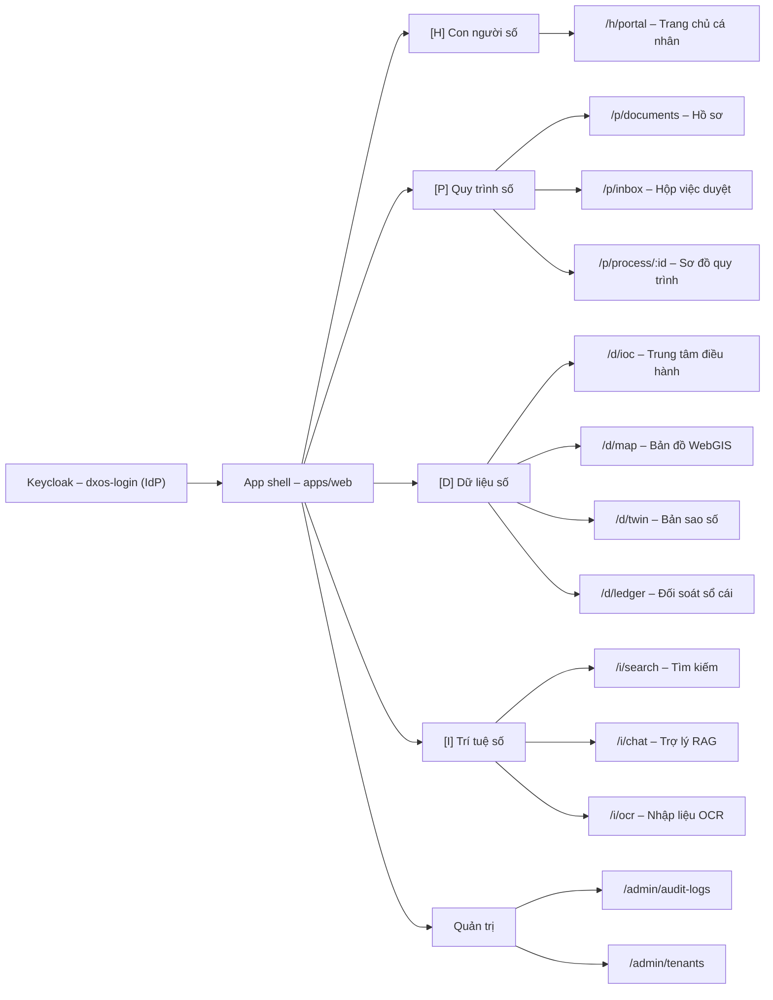
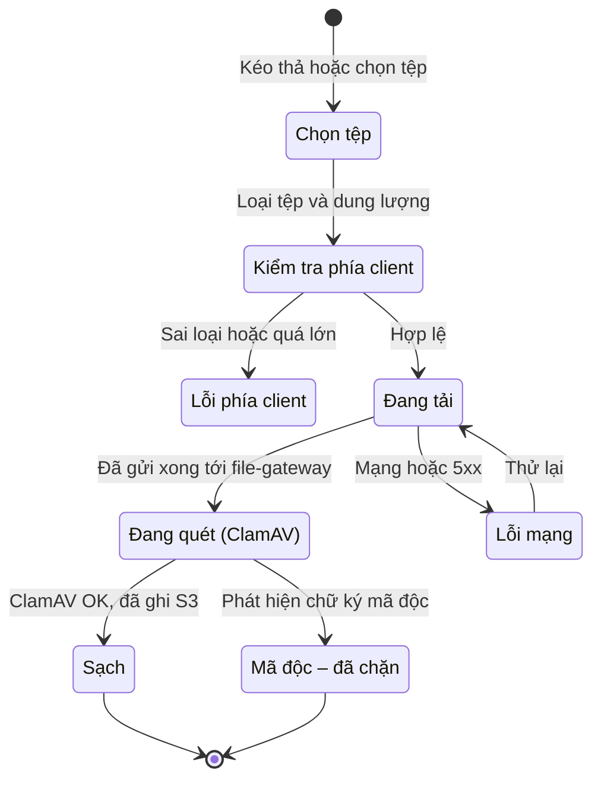
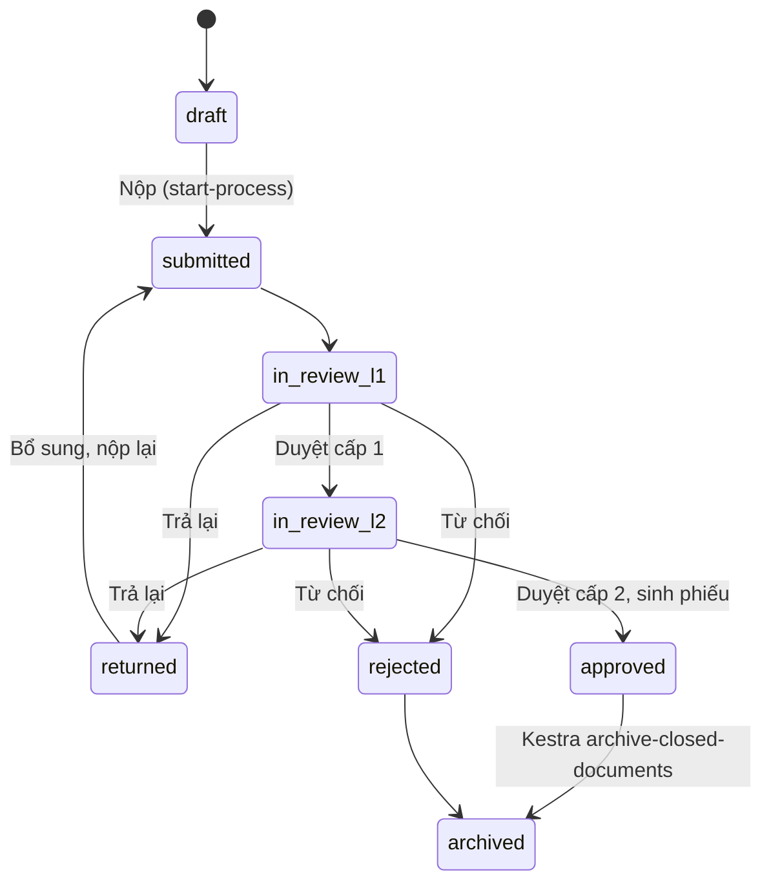
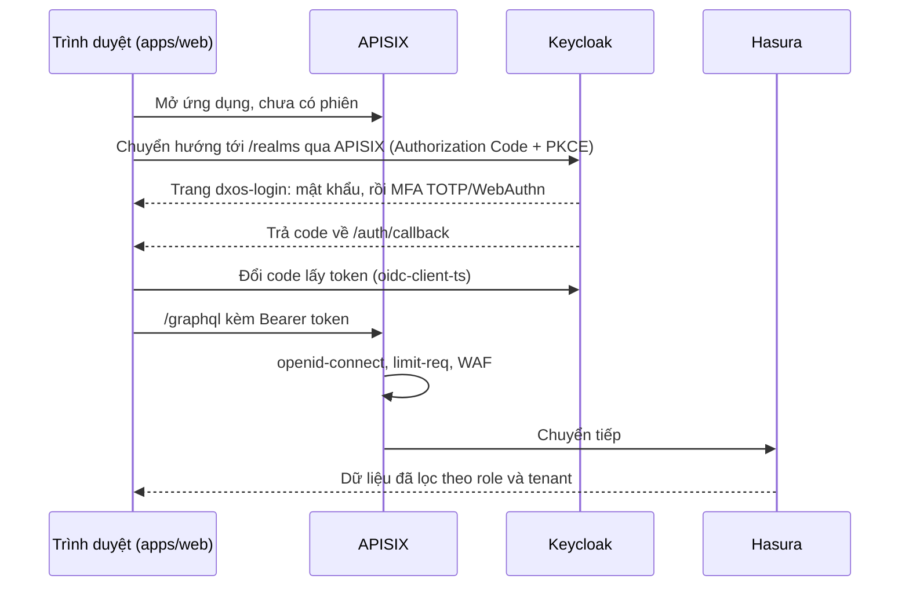
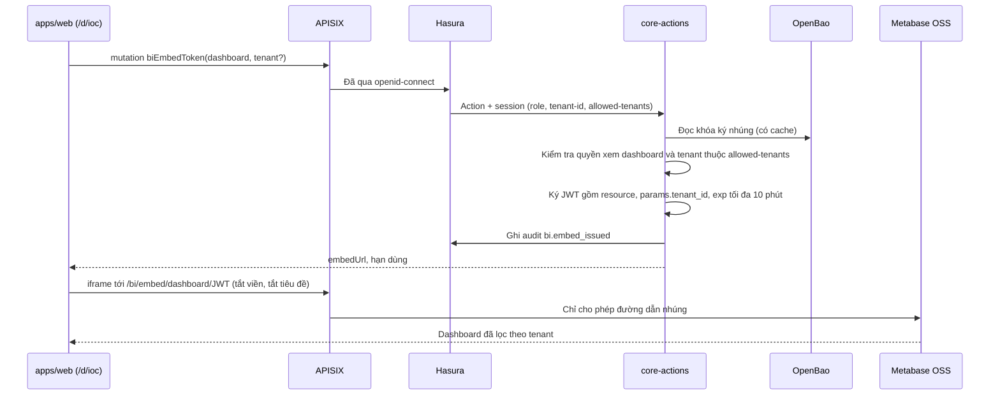

# UI.md — Thiết kế giao diện DX-OS Open-Core (Bamboo)

> **Phạm vi:** Tầng 2 – Không gian năng lực số (`apps/web`, Refine v5 + Ant Design 5) và lớp BI nhúng (`apps/bi/metabase`).
> **Căn cứ:** Đề thi PMNM OLP 2026 (mục 2, 3, 4, 6) và tài liệu *Danh mục thư viện và cây thư mục dự án* của nhóm (mục 1.4, 3, 8, 9).
> **Bối cảnh demo:** tập đoàn đa ngành giả lập gồm công ty mẹ và 4 công ty con: điện thoại, chip & linh kiện, gia dụng, bệnh viện.

**Quy ước trong tài liệu**

- **PHẢI / NÊN / CÓ THỂ**: mức bắt buộc của một ràng buộc (tương đương MUST / SHOULD / MAY).
- Mã yêu cầu dùng lại bảng 1.1 của nhóm: `B1…B6`, `HL`, `NL1…NL4`, `KG-H/P/D/I`, `MT`, `VH`, `NM`, `CK`.
- **[Đề xuất]**: tệp, thư mục hoặc route chưa có trong cây thư mục hiện tại, cần nhóm duyệt trước khi thêm. Tổng hợp ở mục 13.
- Đường dẫn tệp tính từ `apps/web/src/` nếu không ghi rõ.

## Mục lục

1. [Nguyên tắc thiết kế giao diện](#1-nguyên-tắc-thiết-kế-giao-diện)
2. [Người dùng, vai trò và quyền](#2-người-dùng-vai-trò-và-quyền)
3. [Kiến trúc thông tin và định tuyến](#3-kiến-trúc-thông-tin-và-định-tuyến)
4. [Khung ứng dụng (App shell)](#4-khung-ứng-dụng-app-shell)
5. [Hệ thống thiết kế](#5-hệ-thống-thiết-kế-srctheme)
6. [Thành phần dùng chung](#6-thành-phần-dùng-chung-srccomponents)
7. [Đặc tả màn hình theo không gian H-P-D-I](#7-đặc-tả-màn-hình-theo-không-gian-h-p-d-i)
8. [Luồng tương tác và trạng thái hệ thống](#8-luồng-tương-tác-và-trạng-thái-hệ-thống)
9. [BI – Trung tâm điều hành và ràng buộc giao diện kiểu Power BI](#9-bi--trung-tâm-điều-hành-và-ràng-buộc-giao-diện-kiểu-power-bi)
10. [Đa ngôn ngữ](#10-đa-ngôn-ngữ)
11. [Hiệu năng và chất lượng frontend](#11-hiệu-năng-và-chất-lượng-frontend)
12. [Ánh xạ màn hình – yêu cầu đề – kịch bản demo](#12-ánh-xạ-màn-hình--yêu-cầu-đề--kịch-bản-demo)
13. [Đề xuất bổ sung vào cây thư mục](#13-đề-xuất-bổ-sung-vào-cây-thư-mục)
14. [Thứ tự triển khai giao diện trong 4 tuần](#14-thứ-tự-triển-khai-giao-diện-trong-4-tuần)
15. [Nguồn tham khảo](#15-nguồn-tham-khảo)

---

## 1. Nguyên tắc thiết kế giao diện

| Mã | Nguyên tắc | Hệ quả trên giao diện | Căn cứ |
|---|---|---|---|
| UI-01 | Một giao diện duy nhất, nằm ở Tầng 2 | Mọi màn hình người dùng cuối nằm trong `apps/web`. Tầng 1 không có trang nào. Trang đăng nhập là theme Keycloak (`themes/dxos-login`), thuộc IdP chứ không thuộc ứng dụng. | Đề mục 3, `HL`, ADR 0007 |
| UI-02 | Chỉ đi qua cổng API | Frontend chỉ biết một origin là APISIX, với các tiền tố `/graphql`, `/files`, `/rt`, `/ai`, `/ngsi-ld`, `/realms` (thêm `/bi`, `/gis` – [Đề xuất]). Bundle không chứa URL nội bộ của Hasura, Flowable, Metabase. | `B2`, `NL4` |
| UI-03 | Điều hướng theo chuỗi H → P → D → I | Sider chia 4 nhóm theo không gian năng lực, mỗi nhóm có màu và biểu tượng riêng. Thứ tự cố định để thể hiện mức trưởng thành số. | Đề mục 1, 2 |
| UI-04 | Đa thuê ước luôn nhìn thấy được | Tenant hiện tại luôn hiện ở header. Chỉ tài khoản công ty mẹ thấy bộ chuyển tenant. Dữ liệu của tenant khác không bao giờ xuất hiện, kể cả trong gợi ý tìm kiếm và thông báo. | `MT` |
| UI-05 | Thời gian thực là mặc định | Danh sách hồ sơ, hộp việc, thông báo, bản sao số tự cập nhật (liveProvider + Centrifugo), có chỉ báo "Trực tiếp". | Đề lớp 1, `KG-D` |
| UI-06 | Bảo mật phải thấy được | Kết quả quét mã độc, trạng thái MFA, trường đã che PII, mã băm sổ cái được hiển thị tường minh để giám khảo quan sát được nguyên lý Zero-Trust. | `NL4`, `CK` |
| UI-07 | Nhiệt độ dữ liệu thấy được | Số liệu và hồ sơ mang nhãn Nóng / Ấm / Lạnh. Hồ sơ ở kho lạnh mở trong "Phòng đọc ảo" chỉ đọc. | `NL1`, Đề `KG-D` |
| UI-08 | Số liệu có nguồn gốc | Mỗi KPI có nút "Định nghĩa và nguồn", dẫn tới phả hệ (OpenMetadata) và trạng thái kiểm định chất lượng (Soda). | `NL3` |
| UI-09 | Thiết kế cho buổi demo 15 phút | Mỗi màn hình gắn với ít nhất một kịch bản trong `demo/`. Có tài khoản demo cho từng công ty con. | `CK` |
| UI-10 | Không truyền tải ý nghĩa chỉ bằng màu | Trạng thái luôn có chữ và biểu tượng. Giao diện đạt WCAG 2.1 AA. | Trợ năng |

---

## 2. Người dùng, vai trò và quyền

### 2.1. Tenant (theo `organizations.yaml`)

| Mã tenant | Tên hiển thị | Biểu tượng (`@ant-design/icons`) | Ví dụ loại hồ sơ *(minh họa – `seeds/02_document_types.sql` quyết định)* |
|---|---|---|---|
| `holding` | Công ty mẹ (Tập đoàn) | `BankOutlined` | Tờ trình đầu tư; Đề xuất mua sắm liên công ty |
| `mobile` | Công ty Điện thoại | `MobileOutlined` | Yêu cầu thay đổi thiết kế (ECR); Báo cáo lỗi dây chuyền SMT |
| `semicon` | Công ty Chip & Linh kiện | `DeploymentUnitOutlined` | Báo cáo sự cố phòng sạch; Phiếu xuất xưởng lô wafer |
| `appliance` | Công ty Gia dụng | `HomeOutlined` | Phiếu bảo hành, đổi trả; Đề xuất chương trình khuyến mại |
| `hospital` | Bệnh viện | `MedicineBoxOutlined` | Đề xuất mua thiết bị y tế; Phiếu kết quả |

### 2.2. Persona (theo `roles.yaml`)

| Persona | Vai trò | Phạm vi tenant | Việc chính trên giao diện | Trang mở đầu |
|---|---|---|---|---|
| Nhân viên | `staff` | Một công ty | Tạo và nộp hồ sơ, theo dõi tiến độ, tra cứu, hỏi trợ lý | `/h/portal` |
| Trưởng bộ phận | `reviewer_l1` | Một công ty | Duyệt cấp 1, trả lại bổ sung | `/p/inbox` |
| Giám đốc khối | `reviewer_l2` | Một công ty | Duyệt cấp 2, phát hành phiếu kết quả | `/p/inbox` |
| Giám đốc | `director` | Một công ty, hoặc toàn tập đoàn nếu thuộc `holding` | Trung tâm điều hành, bản đồ, bản sao số | `/d/ioc` |
| Kiểm toán viên | `auditor` | `holding` (mọi tenant) hoặc một công ty | Nhật ký kiểm toán, đối soát sổ cái; chỉ đọc | `/admin/audit-logs` |

### 2.3. Ma trận quyền giao diện (đề xuất cho `providers/ability.ts`)

Ký hiệu: **✓** đầy đủ trong phạm vi tenant · **R** chỉ đọc · **O** chỉ bản ghi của mình · **—** ẩn hoàn toàn (không hiện menu).

| Resource / hành động | staff | reviewer_l1 | reviewer_l2 | director | auditor |
|---|---|---|---|---|---|
| `documents` xem danh sách, chi tiết | O | ✓ (đơn vị) | ✓ | ✓ | R |
| `documents` tạo, sửa bản nháp | O | O | O | — | — |
| `inbox` / review | — | ✓ cấp 1 | ✓ cấp 2 | R | — |
| `process` sơ đồ quy trình | O | ✓ | ✓ | ✓ | R |
| `ioc` trung tâm điều hành | R (trang "Của tôi") | R | R | ✓ | R |
| `map`, `twin` | R | R | R | ✓ | R |
| `ledger` đối soát sổ cái | ✓ | ✓ | ✓ | ✓ | ✓ |
| `search` | ✓ | ✓ | ✓ | ✓ | R |
| `chat`, `ocr` | ✓ | ✓ | ✓ | ✓ | — |
| `audit-logs` | — | — | — | R (tenant mình) | ✓ |
| `tenants` | — | — | — | R (chỉ `holding`) | R |

Quy tắc áp dụng:

- Ẩn trên giao diện chỉ là lớp phòng thủ đầu tiên. Quyền thật nằm ở Hasura (quyền dòng, cột) và RLS (`migrations/.../0009_rls_policies`). Giao diện **PHẢI** xử lý mã 403 một cách tử tế dù menu đã ẩn.
- Luật CASL dựng từ claim trong token (`https://hasura.io/jwt/claims`: role, `tenant-id`, `allowed-tenants`), không gọi thêm API.
- Ma trận này **PHẢI** được chốt cùng thành viên B để khớp metadata Hasura ở `metadata/databases/default/tables/`.

---

## 3. Kiến trúc thông tin và định tuyến

### 3.1. Sơ đồ trang



### 3.2. Bảng resource (`config/resources.tsx`)

| Resource | Route | Tệp trang | `meta.space` | Nguồn dữ liệu | Live |
|---|---|---|---|---|---|
| `portal` | `/h/portal` | `pages/h-portal/` | H | Hasura + Action `my-tasks` | ✓ |
| `documents` | `/p/documents`, `/create`, `/edit/:id`, `/show/:id` | `pages/p-eoffice/documents/` | P | Hasura | ✓ |
| `inbox` | `/p/inbox`, `/p/inbox/:taskId` | `pages/p-eoffice/inbox/` | P | Action `my-tasks`, `complete-task` | ✓ |
| `process` | `/p/process/:documentId` | `pages/p-eoffice/process/diagram.tsx` | P | Action `process-state` | — |
| `ioc` | `/d/ioc/:page?` | `pages/d-insight/ioc-dashboard.tsx` | D | Hasura (KPI nóng) + Metabase nhúng | ✓ một phần |
| `map` | `/d/map` | `pages/d-insight/map.tsx` | D | Hasura (GeoJSON từ PostGIS) + WMS GeoServer | — |
| `twin` | `/d/twin/:entityId?` | `pages/d-insight/digital-twin.tsx` | D | `ngsi-ld-data-provider` (chỉ đọc) | ✓ |
| `ledger` | `/d/ledger` | `pages/d-insight/ledger-verify.tsx` | D | Action `verify-ledger` | — |
| `search` | `/i/search` | `pages/i-assistant/search.tsx` | I | Action `search-documents` | — |
| `chat` | `/i/chat` | `pages/i-assistant/chat.tsx` | I | `/ai` (SSE) | stream |
| `ocr` | `/i/ocr` | `pages/i-assistant/ocr-intake.tsx` | I | `/ai` (OCR) | — |
| `audit-logs` | `/admin/audit-logs` | `pages/admin/audit-logs.tsx` | admin | Hasura (`audit_events`) | ✓ |
| `tenants` | `/admin/tenants` | `pages/admin/tenants.tsx` | admin | Hasura | — |

### 3.3. Quy ước định tuyến

- Tiền tố route là mã không gian (`h`, `p`, `d`, `i`), để URL tự kể lại kiến trúc H-P-D-I khi trình diễn.
- Trạng thái bảng (trang, sắp xếp, bộ lọc) đồng bộ lên query string (`syncWithLocation`). Nhấn F5 hay gửi link cho người khác đều giữ nguyên bộ lọc.
- Tài khoản công ty con: tenant **không** nằm trong URL mà lấy từ token.
- Tài khoản `holding`: tenant đang chọn nằm ở `?tenant=` để link chia sẻ đúng phạm vi. Hasura vẫn kiểm tra lại với `allowed-tenants`; tham số này chỉ thu hẹp phạm vi, không mở rộng quyền.
- Bản đồ: điểm nhà máy, kho, bệnh viện lấy qua Hasura dạng GeoJSON (đã lọc theo tenant). GeoServer chỉ phát các lớp dùng chung, không nhạy cảm (nền, ranh giới hành chính), qua route `/gis` chỉ cho phép GET – [Đề xuất] `platform/gateway/apisix/routes/gis.yaml`. Như vậy tránh phải dựng phân quyền theo tenant bên trong GeoServer.

---

## 4. Khung ứng dụng (App shell)

### 4.1. Bố cục desktop (≥ 1200 px)

```text
┌──────────────────────────────────────────────────────────────────────────────────────┐
│ [▣ Bamboo · DX-OS]   [● Công ty Chip & Linh kiện ▾]   [⌕ Tìm mọi thứ…   Ctrl K]      │
│                                                     (3) Thông báo   VI|EN   ◐   NA ▾ │
├────────────────┬─────────────────────────────────────────────────────────────────────┤
│ ▌H CON NGƯỜI   │  Trang chủ / Hồ sơ / HS-SEMI-2026-00125                             │
│   Trang chủ    │  ┌───────────────────────────────────────────────────────────────┐  │
│ ▌P QUY TRÌNH   │  │ Tiêu đề trang                       [Hành động phụ] [Chính]   │  │
│   Hồ sơ        │  │ Mô tả ngắn · ● Trực tiếp · [Nóng]                             │  │
│   Hộp việc  (5)│  └───────────────────────────────────────────────────────────────┘  │
│ ▌D DỮ LIỆU     │                                                                     │
│   Điều hành    │                           Nội dung trang                            │
│   Bản đồ       │                                                                     │
│   Bản sao số   │                                                                     │
│   Sổ cái       │                                                                     │
│ ▌I TRÍ TUỆ     │                                                                     │
│   Tìm kiếm     │                                                                     │
│   Trợ lý       │                                                                     │
│   Nhập liệu OCR│                                                                     │
│ ▌QUẢN TRỊ      │                                                                     │
│ « Thu gọn      │  Bamboo v0.x · Apache-2.0 · Mã nguồn · Phiên: MFA ✓                 │
└────────────────┴─────────────────────────────────────────────────────────────────────┘
```

| Thành phần header | Hành vi | Tệp |
|---|---|---|
| Logo và tên | "Bamboo · DX-OS". Nhấn vào thì về `/h/portal`. | `components/layout/` |
| Badge / bộ chuyển tenant | Công ty con: badge tĩnh (chấm màu + tên). `holding`: Select gồm "Toàn tập đoàn" và 4 công ty con. Khi đổi tenant: xóa toàn bộ cache truy vấn, đóng kênh realtime cũ, mở kênh mới, giữ nguyên route. | `components/tenant-switcher/` |
| Tìm kiếm toàn cục (Ctrl/⌘ K) | Bảng lệnh: nhảy tới trang, tìm hồ sơ (Meilisearch), gõ "Hỏi: …" để chuyển câu hỏi sang `/i/chat`. | [Đề xuất] `components/command-palette/` |
| Thông báo | Badge số chưa đọc, dropdown 10 mục mới nhất, nhấn vào thì tới hồ sơ hoặc task, có "Đánh dấu đã đọc tất cả". | `components/notification-bell/` |
| Ngôn ngữ | VI (mặc định) / EN. | `providers/i18n-provider.ts` |
| Sáng / tối | Theo hệ điều hành, có nút ghi đè. Lựa chọn lưu ở `localStorage` (bọc try/catch). | `theme/` |
| Menu người dùng | Tên, vai trò, tenant, trạng thái MFA. "Bảo mật tài khoản" mở trang account của Keycloak ở tab mới. Đăng xuất gọi end-session OIDC. | `providers/auth-provider.ts` |

Sider:

- 4 nhóm H / P / D / I và nhóm Quản trị. Tiêu đề nhóm có vạch màu của không gian.
- Mục ẩn theo CASL; nhóm không còn mục nào thì ẩn cả nhóm.
- Badge số việc chờ cạnh "Hộp việc", cập nhật realtime.
- Từ 992 đến 1199 px thu gọn còn icon; dưới 992 px chuyển thành Drawer.

Footer hiển thị phiên bản, giấy phép Apache-2.0 và link kho mã nguồn, để tính nguồn mở (`NM`) luôn hiện diện.

### 4.2. Điểm ngắt responsive (theo antd)

| Điểm ngắt | Độ rộng | Sider | Bảng dữ liệu | Trung tâm điều hành |
|---|---|---|---|---|
| xs | < 576 | Drawer | Mỗi dòng thành một thẻ | 1 cột: KPI và 1 biểu đồ chính |
| sm | ≥ 576 | Drawer | Thẻ | 1 cột |
| md | ≥ 768 | Drawer | Ẩn cột phụ | 2 cột |
| lg | ≥ 992 | Thu gọn icon | Đầy đủ | 2–3 cột |
| xl | ≥ 1200 | Mở | Đầy đủ | Lưới 24 cột |
| xxl | ≥ 1600 | Mở | Bảng + panel chi tiết bên phải | Lưới 24 cột, hỗ trợ chế độ trình chiếu |

Kích thước kiểm thử bắt buộc: **1366×768** (laptop phổ thông), **1920×1080** (máy chiếu buổi chung kết), **390×844** (điện thoại).

---

## 5. Hệ thống thiết kế (`src/theme/`)

### 5.1. Token Ant Design

```ts
// src/theme/tokens.ts  [Đề xuất]
export const brandTokens = {
  colorPrimary: '#0F766E',          // xanh tre – tương phản 5.47:1 trên nền trắng
  borderRadius: 8,
  fontSize: 14,
  fontFamily: "'Be Vietnam Pro', system-ui, -apple-system, 'Segoe UI', sans-serif",
};
export const brandTokensDark = { ...brandTokens, colorPrimary: '#2DD4BF' }; // 9.9:1 trên #141414
```

- **Phông chữ:** Be Vietnam Pro (SIL OFL-1.1, được OSI công nhận), tự lưu trữ trong `public/fonts/` [Đề xuất]. Lý do: phủ đủ dấu tiếng Việt; không gọi Google Fonts nên chạy được khi demo offline và không lộ IP người dùng cho bên thứ ba. Thêm vào `REUSE.toml` và `NOTICE`.
- Số trong bảng và trục biểu đồ dùng `font-variant-numeric: tabular-nums` để thẳng cột.

### 5.2. Màu theo vai trò

**a) Màu không gian H-P-D-I**, lấy theo Hình 1 của đề. Chỉ dùng cho khung giao diện (tiêu đề nhóm menu, vạch trang, chip), **không** dùng trong biểu đồ.

| Không gian | Sáng | Tối | Biểu tượng |
|---|---|---|---|
| H – Con người số | `#2B6CB0` | `#63B3ED` | `TeamOutlined` |
| P – Quy trình số | `#2F855A` | `#68D391` | `ApartmentOutlined` |
| D – Dữ liệu số | `#C05621` | `#F6AD55` | `DashboardOutlined` |
| I – Trí tuệ số | `#6B46C1` | `#B794F4` | `RobotOutlined` |

Tất cả đạt ≥ 4.5:1 khi làm màu chữ trên nền tương ứng (đã đo).

**b) Màu tenant**, dùng chung cho badge **và** biểu đồ. Màu đi theo thực thể: Công ty Điện thoại luôn là xanh dương ở mọi biểu đồ, mọi trang.

| Tenant | Sáng | Tối | Ghi chú |
|---|---|---|---|
| `mobile` | `#2a78d6` | `#3987e5` | Slot 1 |
| `semicon` | `#eb6834` | `#d95926` | Slot 2 |
| `appliance` | `#1baf7a` | `#199e70` | Slot 3 |
| `hospital` | `#eda100` | `#c98500` | Slot 4 |
| `holding` | Mực chính (`#0b0b0b` / `#ffffff`) | | Đường "Toàn tập đoàn" là tổng, không phải một chuỗi màu |

Kết quả chạy bộ kiểm tra bảng màu (lightness, chroma, mù màu CVD, tương phản):

- Biểu đồ cột, đường, cột chồng (các cặp kề nhau): **đạt** cả hai chế độ. CVD ΔE tệ nhất 9.1 (sáng) / 8.4 (tối); thị lực thường 22.9 / 19.8.
- Bản đồ, scatter (mọi cặp đều có thể đứng cạnh nhau): **không đạt** sàn thị lực thường (vàng ↔ cam ΔE 13.7 < 15). Vì vậy trên bản đồ và scatter, mỗi công ty **PHẢI** có biểu tượng hình dạng riêng (nhà máy, chip, ngôi nhà, chữ thập), không chỉ phân biệt bằng màu.
- `#1baf7a` và `#eda100` có tương phản < 3:1 trên nền sáng, nên biểu đồ dùng hai màu này **PHẢI** có nhãn trực tiếp hoặc nút "Xem dạng bảng".
- Badge tenant: chấm màu + chữ màu mực. Không tô chữ bằng màu tenant.

**c) Màu trạng thái** (cố định, không dùng làm màu chuỗi dữ liệu, luôn đi kèm biểu tượng và nhãn): tốt `#0ca30c` · cảnh báo `#fab219` · nghiêm trọng `#ec835a` · nguy cấp `#d03b3b`.

**d) Trạng thái hồ sơ** (`components/status-tag/`):

| Mã | Nhãn | Màu | Biểu tượng |
|---|---|---|---|
| `draft` | Nháp | Xám | `EditOutlined` |
| `submitted` | Đã nộp | Xanh (processing) | `SendOutlined` |
| `in_review_l1` | Chờ duyệt cấp 1 | Cảnh báo | `ClockCircleOutlined` |
| `in_review_l2` | Chờ duyệt cấp 2 | Cảnh báo | `ClockCircleOutlined` |
| `returned` | Trả lại bổ sung | Nghiêm trọng | `RollbackOutlined` |
| `approved` | Đã duyệt | Tốt | `CheckCircleOutlined` |
| `rejected` | Từ chối | Nguy cấp | `CloseCircleOutlined` |
| `archived` | Lưu trữ (kho lạnh) | Xám xanh | `LockOutlined` |

> Mã trạng thái **PHẢI** khớp enum trong migration `0004_documents_files_versions` và `0005_approval_history_tasks`; cần chốt cùng thành viên B.

**e) Nhiệt độ dữ liệu** ([Đề xuất] `components/data-temperature/`):

| Nhãn | Ý nghĩa | Nguồn điển hình | Biểu tượng |
|---|---|---|---|
| Nóng | Thời gian thực, giao dịch | Postgres qua Hasura subscription, Centrifugo, NGSI-LD | `FireOutlined` |
| Ấm | Gần thời gian thực, phân tích | Trino trên Iceberg/Postgres, cache vài phút | `HistoryOutlined` |
| Lạnh | Lưu trữ, đã chốt kỳ, bất biến | Bucket `archive`, snapshot Iceberg, immudb | `CloudServerOutlined` |

### 5.3. Định dạng dữ liệu

- **Số:** `Intl.NumberFormat('vi-VN')` → `1.234.567,8`. Rút gọn: nghìn / tr / tỷ (ví dụ `1,2 tỷ ₫`).
- **Tiền:** `12.500.000 ₫`, canh phải trong bảng.
- **Ngày giờ:** `DD/MM/YYYY HH:mm`, múi giờ `Asia/Ho_Chi_Minh` (dayjs + plugin `utc`, `timezone`). Thông báo dùng thời gian tương đối ("5 phút trước"), tooltip hiện giờ tuyệt đối.
- **Phần trăm:** một chữ số thập phân, `98,7%`.
- **Mã hồ sơ:** phông mono, ví dụ `HS-SEMI-2026-00125` (định dạng minh họa).

### 5.4. Khoảng cách, mật độ

- Lưới 8 px. Padding trang 24 px trên desktop, 16 px trên mobile.
- Bảng: `size="middle"` mặc định; `size="small"` cho trung tâm điều hành và nhật ký kiểm toán.
- Vùng chạm tối thiểu 32 px trên desktop, 44 px trên mobile.

### 5.5. Sáng / tối

- antd dùng `theme.darkAlgorithm`. ECharts đăng ký hai theme `dxos-light` và `dxos-dark` dựng từ cùng bộ token ([Đề xuất] `theme/echarts-theme.ts`).
- Metabase nhúng ở chế độ tối dùng tham số `#theme=night`.
- Theme đăng nhập Keycloak dùng cùng màu và phông để người dùng không thấy "nhảy" sang một sản phẩm khác.

### 5.6. Trợ năng (WCAG 2.1 AA)

- Chữ đạt tương phản ≥ 4.5:1; vòng focus 2 px màu `colorPrimary`, luôn hiện khi điều hướng bằng bàn phím.
- Toàn bộ thao tác duyệt hồ sơ làm được bằng bàn phím. Trang duyệt có phím tắt `J` / `K` (hồ sơ kế / trước); "Duyệt" và "Trả lại" luôn mở hộp xác nhận.
- Thông báo realtime dùng `aria-live="polite"`, không cướp focus.
- Tôn trọng `prefers-reduced-motion`: tắt animation của ECharts và hiệu ứng chuyển trang.

---

## 6. Thành phần dùng chung (`src/components/`)

### 6.1. Thành phần đã có trong cây thư mục

| Thành phần | Mục đích | Hành vi bắt buộc |
|---|---|---|
| `layout/` | Header, sider nhóm theo H-P-D-I, breadcrumb, footer | Như mục 4. Dùng `ThemedLayout` của `@refinedev/antd`, ghi đè header và sider. |
| `tenant-switcher/` | Chuyển phạm vi tenant cho tài khoản `holding` | Chỉ render khi `allowed-tenants` có hơn 1 phần tử. Đổi tenant thì xóa cache React Query và mở lại kênh realtime. |
| `notification-bell/` | Thông báo realtime qua Centrifugo | Đăng ký kênh cá nhân và kênh tenant (tên kênh chốt trong `centrifugo/config.json`). Tự kết nối lại với backoff. Không bao giờ hiển thị thông báo của tenant khác. |
| `file-upload/` | Tải tệp qua `/files`, hiển thị kết quả quét | Máy trạng thái ở mục 6.3. **Không** dùng presigned PUT (quyết định 1.4 của nhóm). |
| `pdf-viewer/` | Xem PDF trong trang (react-pdf) | Thanh công cụ: thu phóng, chuyển trang, tìm chữ. Có chế độ "Phòng đọc ảo" (mục 6.4). |
| `bpmn-viewer/` | Hiển thị sơ đồ quy trình, tô sáng bước hiện tại | Dùng `NavigatedViewer` của bpmn-js. Bước đang chạy tô viền đậm, bước đã xong tô nhạt, có chú giải. Nhấn vào một task thì hiện người xử lý và thời điểm. **PHẢI giữ watermark bpmn.io** (điều kiện giấy phép). |
| `status-tag/` | Nhãn trạng thái hồ sơ | Theo bảng 5.2d: luôn có chữ và biểu tượng. |

### 6.2. Thành phần [Đề xuất] bổ sung

| Thành phần | Mục đích |
|---|---|
| `command-palette/` | Bảng lệnh Ctrl/⌘ K (mục 4.1). |
| `data-temperature/` | Badge Nóng / Ấm / Lạnh (mục 5.2e). |
| `live-indicator/` | Chấm "Trực tiếp" kèm "Cập nhật lúc hh:mm:ss"; chuyển xám và hiện "Mất tín hiệu" khi quá ngưỡng không có dữ liệu. |
| `pii-text/` | Hiển thị giá trị đã che (ví dụ `0912 *** 678`), tooltip "Đã che theo chính sách pii-guard của tenant". Không có nút "hiện đầy đủ" trong phạm vi bài thi. |
| `dynamic-form/` | Dựng form antd từ schema của loại hồ sơ (`document_types`), để thêm loại hồ sơ mới mà không phải sửa mã frontend. |
| `audit-timeline/` | Dòng thời gian nộp, duyệt, trả lại, phát hành phiếu. |
| `lineage-link/` | Popover "Định nghĩa và nguồn" của KPI: công thức, đơn vị, chủ sở hữu, tần suất làm mới, trạng thái kiểm định, link sang OpenMetadata. |
| `kpi-card/`, `visual-frame/`, `filter-pane/` | Bộ thành phần BI (mục 9). |
| `states/` | Bộ trạng thái chuẩn: skeleton, empty, error có mã truy vết, 403, 404. |

### 6.3. Máy trạng thái `file-upload`



| Trạng thái | Hiển thị |
|---|---|
| Đang tải | Thanh tiến trình %, tên tệp, nút hủy. |
| Đang quét | Biểu tượng `SecurityScanOutlined` xoay, chữ "Đang kiểm dịch tại biên (ClamAV)…". |
| Sạch | `CheckCircleOutlined` màu tốt, "Sạch", SHA-256 rút gọn (`3f9a…c21e`) có nút sao chép. |
| Mã độc | Khung màu nguy cấp, "Tệp chứa mã độc – đã chặn, không được lưu", tên chữ ký (ví dụ `Eicar-Test-Signature`). Đây là khoảnh khắc demo của `demo/01-zero-trust/eicar-upload.sh`. |
| Lỗi | Thông điệp theo mục 8.3, nút "Thử lại". |

Ràng buộc:

- Danh sách loại tệp cho phép (PDF, DOCX, PNG, JPG) và dung lượng tối đa đọc từ `config/env.ts`, khớp giới hạn của route `files.yaml`.
- Nút "Tiếp tục" của form nộp hồ sơ bị khóa cho tới khi mọi tệp ở trạng thái "Sạch".

### 6.4. Chế độ "Phòng đọc ảo" của `pdf-viewer`

Đề yêu cầu "Phòng đọc ảo bảo mật chống sửa xóa" cho kho dữ liệu lạnh, và "giải mã an toàn tài liệu trên RAM" ở không gian Quy trình số. Chế độ này áp dụng cho hồ sơ `archived`:

- Tải tệp về dạng `ArrayBuffer` và render bằng pdf.js ngay trong bộ nhớ; thu hồi object URL khi rời trang. Phía máy chủ trả header `Cache-Control: no-store`.
- Ẩn nút tải xuống và in; chặn menu chuột phải trên vùng xem.
- Phủ watermark chéo gồm họ tên, tenant và thời điểm mở.
- Mỗi lần mở ghi một sự kiện `document.viewed` vào `audit_events`.
- Ghi rõ trong tài liệu và khi thuyết trình: trình duyệt không thể ngăn tuyệt đối việc chụp màn hình. Mục tiêu ở đây là răn đe và truy vết, không phải chống sao chép tuyệt đối.

---

## 7. Đặc tả màn hình theo không gian H-P-D-I

### 7.1. [H] Trang chủ cá nhân – `/h/portal`

**Mục tiêu:** điểm vào duy nhất cho mọi người dùng; trả lời câu hỏi "hôm nay tôi cần làm gì".

```text
┌ Chào buổi sáng, Ngọc Anh · Công ty Chip & Linh kiện · Thứ Bảy, 03/10/2026 ───────────────────┐
│ [Việc chờ tôi 5]  [Hồ sơ của tôi đang xử lý 3]  [Quá hạn SLA 1]  [Thông báo chưa đọc 4]      │
├────────────────────────────────────────────────┬─────────────────────────────────────────────┤
│ Việc của tôi        [Danh sách|Kanban|Lịch]    │ Thông báo gần đây                           │
│ ● HS-SEMI-…125  Sự cố phòng sạch    còn 4 giờ  │ • HS-…118 đã được duyệt cấp 1 · 5 phút      │
│ ● HS-SEMI-…121  Xuất xưởng lô W-77  còn 1 ngày │ • Tệp "bao-cao.pdf" bị chặn · 1 giờ trước   │
├────────────────────────────────────────────────┼─────────────────────────────────────────────┤
│ Hồ sơ gần đây                                  │ Lối tắt                                     │
│ (bảng 5 dòng, status-tag, nhiệt độ)            │ [+ Tạo hồ sơ] [Nhập bằng OCR]               │
│                                                │ [Hỏi trợ lý] [Đối soát tệp]                 │
│                                                │ KPI đã ghim từ trung tâm điều hành          │
└────────────────────────────────────────────────┴─────────────────────────────────────────────┘
```

- Bốn thẻ đếm ở đầu trang nhấn được, dẫn tới danh sách đã lọc sẵn.
- **Việc của tôi** có ba chế độ xem, đáp ứng "Bảng điều khiển hiệu suất công việc (Kanban & Lịch)" của đề ở `KG-H`:
  - Danh sách: sắp theo hạn SLA tăng dần.
  - Kanban: cột theo trạng thái hồ sơ của tôi (chỉ để xem, không kéo thả để đổi trạng thái vì trạng thái do quy trình BPMN quyết định).
  - Lịch: `Calendar` của antd, đánh dấu ngày đến hạn SLA.
- **KPI đã ghim**: người dùng ghim thẻ KPI từ `/d/ioc` (tương đương "Pin to dashboard" của Power BI). Lưu theo người dùng ([Đề xuất] bảng `user_preferences`).
- Ưu tiên: danh sách và thông báo là **Bắt buộc**; Kanban, Lịch, KPI ghim là **Demo**.

### 7.2. [P] e-Office – ứng dụng minh họa chính (`B6`)

#### 7.2.1. Danh sách hồ sơ – `/p/documents`

| Cột | Ghi chú |
|---|---|
| Mã hồ sơ | Phông mono, nhấn vào thì mở chi tiết |
| Tiêu đề | Cắt bớt 1 dòng, tooltip đầy đủ |
| Loại hồ sơ | Theo `document_types` của tenant |
| Công ty | **Chỉ hiện với `holding`**: badge tenant |
| Người nộp, Đơn vị | Từ hồ sơ người dùng và đơn vị (migration `0001_tenants_org_units`, `0002_users_profile`) |
| Trạng thái | `status-tag` |
| Bước hiện tại, Hạn SLA | Hạn SLA còn < 25% thời gian thì hiện màu cảnh báo kèm biểu tượng; quá hạn hiện màu nguy cấp |
| Cập nhật | Thời gian tương đối |
| Nhiệt độ | `data-temperature` |

- **Thanh lọc** phía trên bảng, trên một hàng: từ khóa, loại, trạng thái (chọn nhiều), khoảng ngày (hôm nay, 7 ngày, 30 ngày, tháng này, tùy chọn), công tắc "Chỉ của tôi". Tất cả đồng bộ lên URL.
- **Realtime:** `liveMode: "manual"`. Khi có thay đổi, hiện dải "Có 2 cập nhật mới – [Làm mới]" thay vì tự chèn dòng. Lý do: không để dòng nhảy vị trí ngay dưới con trỏ chuột của người dùng.
- Phân trang phía máy chủ, mặc định 20 dòng mỗi trang.
- Hành động trên dòng: Xem · Sửa (chỉ `draft` / `returned` và là người nộp) · Xem quy trình.

#### 7.2.2. Tạo hồ sơ – `/p/documents/create`

Dùng `Steps` gồm 4 bước:

1. **Chọn loại hồ sơ:** lưới thẻ theo `document_types` của tenant; mỗi thẻ ghi mô tả, SLA, số cấp duyệt.
2. **Thông tin:** `dynamic-form`. Có nút "Điền tự động từ bản scan" chuyển sang `/i/ocr`, quay lại với các trường đã điền sẵn. Trường có độ tin cậy OCR < 0,8 được tô vàng kèm chữ "Kiểm tra lại".
3. **Tệp đính kèm:** `file-upload`. Chỉ đi tiếp khi mọi tệp đều "Sạch".
4. **Xem lại và nộp:** tóm tắt và tuyến duyệt dự kiến (Nộp → Cấp 1 → Cấp 2 → Phiếu kết quả). Hai nút: "Lưu nháp" và "Nộp hồ sơ". Nộp gọi Action `start-process`; thành công thì hiện `Result` kèm mã hồ sơ và link tới chi tiết.

Bật `warnWhenUnsavedChanges` để cảnh báo khi rời trang mà chưa lưu.

#### 7.2.3. Chi tiết hồ sơ – `/p/documents/show/:id`

- **Header:** mã, tiêu đề, `status-tag`, nhiệt độ, công ty. Hành động: Sửa (nháp) · Tải phiếu kết quả (khi `approved`) · Xác minh sổ cái.
- **Tab:**

| Tab | Nội dung |
|---|---|
| Thông tin | Các trường của hồ sơ; trường nhạy cảm dùng `pii-text` |
| Tệp đính kèm | Danh sách tệp (trạng thái quét, SHA-256) và `pdf-viewer` |
| Quy trình | `bpmn-viewer` tô sáng bước hiện tại (Action `process-state`) |
| Lịch sử duyệt | `audit-timeline`: ai, khi nào, quyết định, ý kiến |
| Sổ cái | Mã băm, mã giao dịch immudb, nút "Xác minh ngay" |
| Nhật ký | Sự kiện `audit_events` của hồ sơ này (chỉ `director`, `auditor`) |

- **Realtime:** `liveMode: "auto"`. Khi người duyệt ra quyết định, trạng thái đổi tại chỗ kèm toast.

#### 7.2.4. Hộp việc – `/p/inbox`

Bảng task từ Action `my-tasks`, gồm các cột: Hồ sơ · Loại · Người nộp · Cấp duyệt · Nhận lúc · Hạn SLA (đếm ngược) · Công ty (với `holding`). Mặc định sắp theo hạn SLA tăng dần. Số việc chờ đồng bộ với badge ở sider.

#### 7.2.5. Duyệt hồ sơ – `/p/inbox/:taskId`

```text
┌ Duyệt HS-SEMI-2026-00125 · Cấp 1 · còn 3 giờ 20 phút ──────────────────── [◀ K]  [J ▶] ┐
├────────────────────────────────────────────────┬───────────────────────────────────────┤
│ [Tệp 1: bao-cao-su-co.pdf ▾]   − 100% +   1/4  │ Thông tin hồ sơ (chỉ đọc)             │
│                                                │ Người nộp · Đơn vị · Loại · Giá trị   │
│                                                │ Tệp: ✓ Sạch (ClamAV) · SHA-256 3f9a…  │
│                   PDF viewer                   │ Lịch sử: Nộp 02/10/2026 09:12         │
│                                                │ ───────────────────────────────────── │
│                                                │ Ý kiến (bắt buộc khi trả lại/từ chối) │
│                                                │ [                                   ] │
│                                                │ [Từ chối] [Trả lại bổ sung] [Duyệt]   │
└────────────────────────────────────────────────┴───────────────────────────────────────┘
```

- Quyết định gọi Action `complete-task` theo kiểu **pessimistic**: nút chuyển sang loading, khóa bấm lặp; không cập nhật giao diện trước khi máy chủ xác nhận.
- Thành công thì tự chuyển sang task kế tiếp, toast "Đã duyệt. Chuyển sang hồ sơ kế tiếp".
- Duyệt cấp 2 kích hoạt `generate-result-pdf`: hiện "Đang phát hành phiếu kết quả…" rồi hiện link tải phiếu.
- Task đã được người khác xử lý (Flowable trả lỗi): hiện modal "Việc này đã được xử lý bởi … lúc …" và làm mới hộp việc.
- Ba quyết định Duyệt / Trả lại / Từ chối ứng với các nhánh ra của `document-approval.bpmn20.xml`. Nếu sau này có quy trình khác, danh sách quyết định **NÊN** lấy từ form của task thay vì viết cứng.

#### 7.2.6. Vòng đời hồ sơ hiển thị trên giao diện



> Sơ đồ dựng theo mô tả "Nộp → duyệt cấp 1 → cấp 2 → sinh phiếu" trong cây thư mục. Nếu BPMN thật khác, cập nhật đồng thời sơ đồ này, `status-tag` và bộ lọc trạng thái.

### 7.3. [D] Dữ liệu số

#### 7.3.1. Trung tâm điều hành – `/d/ioc`

Xem mục 9 (toàn bộ phần BI).

#### 7.3.2. Bản đồ WebGIS – `/d/map`

```text
┌ Bản đồ tài sản tập đoàn ──────────────────────────────────────────────────────────────┐
│ ┌ Lớp ───────────────┐                                                ┌ Chi tiết ────┐│
│ │ ☑ Nhà máy điện thoại│              (bản đồ MapLibre)                │ Nhà máy chip ││
│ │ ☑ Nhà máy chip      │       ▲  ◆                                    │ Bắc Ninh     ││
│ │ ☑ Kho gia dụng      │            ■      ✚                           │ ● Phòng sạch ││
│ │ ☑ Bệnh viện         │                                               │   ISO 5: OK  ││
│ │ ☐ Ranh giới (WMS)   │                                               │ [Bản sao số] ││
│ └─────────────────────┘                                               │ [Hồ sơ liên  ││
│                                                                       │   quan]      ││
│  © OpenStreetMap contributors (nếu dùng dữ liệu OSM)                  └──────────────┘│
└───────────────────────────────────────────────────────────────────────────────────────┘
```

- Điểm tài sản: GeoJSON từ Hasura (PostGIS). Mỗi công ty một **hình dạng** biểu tượng riêng và một màu tenant (mục 5.2b). Gom cụm khi có nhiều điểm gần nhau.
- Nhấn vào một điểm thì mở panel chi tiết: tên, địa chỉ, trạng thái thiết bị (qua bảng ánh xạ `0008_assets_twin_mapping`), nút sang bản sao số và hồ sơ liên quan.
- Lớp nền **PHẢI** chạy được khi không có Internet: lấy từ GeoServer, hoặc chấp nhận nền tối giản (ranh giới hành chính). Nếu dùng dữ liệu OSM thì phải ghi công theo giấy phép ODbL.

#### 7.3.3. Bản sao số – `/d/twin`

```text
┌ Bản sao số ──────────────────────────────────────────────────────────────────────────────┐
│ [Tất cả ▾] [Dây chuyền SMT] [Phòng sạch] [Thiết bị y tế]          ● Trực tiếp 10:42:07   │
├──────────────────────┬───────────────────────────────────────────────────────────────────┤
│ ● SMT-01  Đang chạy  │ Phòng sạch CR-02 · Nhà máy chip Bắc Ninh                          │
│ ● SMT-02  Cảnh báo   │ ┌────────────┐ ┌────────────┐ ┌────────────┐ ┌────────────┐       │
│ ● CR-01   Bình thường│ │ Hạt ≥0,5µm │ │ Nhiệt độ   │ │ Độ ẩm      │ │ Chênh áp   │       │
│ ● CR-02   Nguy cấp   │ │ 3.120/m³   │ │ 21,4 °C    │ │ 45 %       │ │ 12 Pa      │       │
│ ● MD-ICU-07 Đang dùng│ └────────────┘ └────────────┘ └────────────┘ └────────────┘       │
│                      │ Lịch sử 1 giờ (Temporal API)  [1h|24h|7 ngày]                     │
│                      │ (biểu đồ đường, có vạch ngưỡng ISO 5: 3.520 hạt/m³)               │
│                      │ [Tạo hồ sơ sự cố từ cảnh báo này]                                 │
└──────────────────────┴───────────────────────────────────────────────────────────────────┘
```

- Nguồn: `ngsi-ld-data-provider` (chỉ GET qua `/ngsi-ld`). Mô hình theo `platform/iot/ngsi-ld/models/`: `ProductionLine`, `CleanRoom`, `MedicalDevice`. Tên thuộc tính trên giao diện **PHẢI** khớp mô hình.
- Cập nhật: polling 5 giây; nếu `iot-bridge` phát sự kiện qua Centrifugo thì chuyển sang đẩy ([Đề xuất]). Quá 30 giây không có dữ liệu thì hiện "Mất tín hiệu" màu xám.
- Vượt ngưỡng: màu trạng thái kèm biểu tượng và chữ (Bình thường / Cảnh báo / Nguy cấp).
- **Nút "Tạo hồ sơ sự cố từ cảnh báo này"**: mở form tạo hồ sơ với loại "Báo cáo sự cố", gắn sẵn mã thực thể và ảnh chụp số liệu tại thời điểm cảnh báo. Đây là minh họa trực quan nhất cho nguyên lý hội tụ IT/OT (`NL2`): dữ liệu vận hành (OT) sinh ra hồ sơ nghiệp vụ (IT) trong cùng một luồng.

#### 7.3.4. Đối soát sổ cái – `/d/ledger`

Hai cách xác minh:

1. **Theo mã hồ sơ:** gọi Action `verify-ledger` để đối chiếu mã băm đang lưu với immudb.
2. **Theo tệp:** người dùng kéo thả tệp, trình duyệt tự tính SHA-256 bằng Web Crypto (`crypto.subtle.digest`). Tệp không rời khỏi máy, chỉ mã băm được gửi đi.

Kết quả:

- **✓ Khớp sổ cái:** mã giao dịch immudb, thời điểm niêm phong, hồ sơ gốc.
- **✗ Không khớp:** "Tệp đã bị thay đổi so với bản đã niêm phong", hiện hai mã băm cạnh nhau.

Ràng buộc: `crypto.subtle.digest` cần nạp cả tệp vào bộ nhớ, nên giới hạn tệp ≤ 100 MB ở chế độ này.

Trang này đồng thời là lối vào "Phòng đọc ảo": danh sách hồ sơ `archived`, mở bằng `pdf-viewer` ở chế độ chỉ đọc (mục 6.4).

### 7.4. [I] Trí tuệ số

#### 7.4.1. Tìm kiếm – `/i/search`

- Ô tìm kiếm lớn, tìm ngay khi gõ (debounce 250 ms), chấp nhận gõ sai chính tả (Meilisearch).
- Bộ lọc nhóm (facet) bên trái: Loại, Trạng thái, Năm, Công ty (với `holding`).
- Kết quả: tiêu đề có tô sáng từ khóa, đoạn trích, `status-tag`, nhiệt độ.
- Không có kết quả: gợi ý "Hỏi trợ lý với câu này".
- Lọc tenant thực hiện ở máy chủ (Action `search-documents` lấy tenant từ token). Giao diện không tự gửi `tenant_id`.

#### 7.4.2. Trợ lý RAG – `/i/chat`

```text
┌ Trợ lý nội bộ · Phạm vi: Công ty Chip & Linh kiện · Mô hình Qwen3 chạy nội bộ ───────────┐
│ Cuộc hội thoại     │ Bạn: Quy trình xử lý sự cố phòng sạch cấp độ 2 là gì?               │
│ • Hôm nay          │ Trợ lý: Theo quy chế vận hành, bước đầu tiên là … [1] … [2]         │
│   Sự cố phòng sạch │ ┌ Nguồn ───────────────────────────────────────────┐                │
│ • Hôm qua          │ │ [1] Quy chế vận hành phòng sạch v3 · trang 12    │                │
│   …                │ │ [2] HS-SEMI-2026-00087 · Báo cáo sự cố           │                │
│                    │ └──────────────────────────────────────────────────┘                │
│                    │ [Nhập câu hỏi…                                    ] [Gửi] [Dừng]    │
│                    │ Câu trả lời do AI tạo – hãy đối chiếu với tài liệu gốc.             │
└────────────────────┴─────────────────────────────────────────────────────────────────────┘
```

- Nhận câu trả lời dạng stream qua `@microsoft/fetch-event-source` (kèm header Authorization). Hiện theo pha: "Đang tìm tài liệu…" → "Đang soạn câu trả lời…". Nút "Dừng" hủy stream.
- Mỗi trích dẫn `[n]` nhấn được, mở hồ sơ hoặc tài liệu đúng trang.
- Không tìm được nguồn phù hợp thì trả lời "Không tìm thấy thông tin trong tài liệu nội bộ", không để mô hình tự bịa.
- `react-markdown` **không** bật HTML thô, để tránh XSS từ nội dung sinh ra.
- Luôn hiện phạm vi tenant đang hỏi, để người dùng biết trợ lý chỉ đọc tài liệu của công ty mình.
- Lịch sử hội thoại giữ trong phiên làm việc; lưu lâu dài là **Mở rộng**.

#### 7.4.3. Nhập liệu OCR – `/i/ocr`

- Tệp scan đi qua `/files` (được quét mã độc) trước, sau đó mới gọi `/ai` để OCR theo mã tệp. Giữ đúng nguyên tắc kiểm dịch tại biên.
- Bố cục hai cột: ảnh có khung bao từng trường ↔ danh sách trường kèm thanh độ tin cậy. Dưới 0,8 tô vàng; dưới 0,5 tô đỏ kèm chữ "Cần nhập tay".
- Nút "Tạo hồ sơ từ kết quả" chuyển sang bước 2 của form tạo hồ sơ với dữ liệu đã điền.

### 7.5. Quản trị

**Nhật ký kiểm toán – `/admin/audit-logs`**

- Cột: Thời điểm · Người thực hiện · Tenant · Hành động (`document.created`, `task.completed`, `file.blocked`, `bi.embed_issued`, `data.exported`…) · Đối tượng · Mã truy vết · Đã niêm phong sổ cái (✓).
- Mở rộng một dòng để xem JSON trước/sau, đã che PII.
- Tên hành động (`document.created`, `file.blocked`, `bi.embed_issued`…) và loại thông báo ở mục 8.6 là quy ước đề xuất; **PHẢI** chốt cùng thành viên B cho bảng `audit_events` và `notifications`.
- `liveMode: "auto"` (nhật ký chỉ thêm, không sửa, nên chèn dòng mới lên đầu không gây rối).
- Xuất CSV theo giới hạn ở mục 9.4 (BI-06).

**Tenant – `/admin/tenants`**

- Thẻ cho từng tenant: tên, số người dùng, số hồ sơ, số thiết bị bản sao số. Chỉ đọc.
- Ghi chú trên trang: "Thay đổi tenant thực hiện bằng cấu hình (`organizations.yaml`) qua GitOps, không sửa trên giao diện". Câu này giúp giám khảo thấy nguyên tắc "cấu hình là mã" của nhóm.

---

## 8. Luồng tương tác và trạng thái hệ thống

### 8.1. Đăng nhập và phiên



- Token giữ trong bộ nhớ hoặc `sessionStorage` (cấu hình `userStore` của oidc-client-ts), không dùng `localStorage`, để giảm thiệt hại nếu có XSS.
- Tự làm mới token trước khi hết hạn. Làm mới thất bại thì hiện modal "Phiên đăng nhập đã hết hạn" và đăng nhập lại, quay về đúng trang cũ.
- Đăng xuất gọi end-session của Keycloak, xóa cache truy vấn, đóng mọi kết nối realtime.

### 8.2. Kết nối thời gian thực

| Kênh | Dùng cho | Thư viện |
|---|---|---|
| Hasura subscription | Danh sách, chi tiết, nhật ký, KPI nóng | `graphql-ws` qua `liveProvider` |
| Centrifugo | Thông báo, sự kiện bản sao số ([Đề xuất]) | `centrifuge` |
| SSE | Stream câu trả lời trợ lý | `@microsoft/fetch-event-source` |

Footer có chỉ báo chung: **● Trực tiếp** (tốt) · **◌ Đang kết nối lại** (cảnh báo) · **✕ Mất kết nối** (nguy cấp). Kết nối lại theo backoff 1 → 2 → 4 … tối đa 30 giây. Kết nối lại xong thì truy vấn lại dữ liệu đang hiển thị.

### 8.3. Ánh xạ lỗi sang thông điệp

| Tình huống | Thông điệp | Hành động |
|---|---|---|
| 401 | "Phiên đăng nhập đã hết hạn" | Làm mới token rồi thử lại một lần; thất bại thì đăng nhập lại |
| 403 | "Bạn không có quyền với tài nguyên này" | Trang 403, nút về trang chủ |
| 404 | "Không tìm thấy" | Trang 404 |
| 409 / task đã xử lý | "Dữ liệu đã được người khác thay đổi" | Làm mới |
| 413 | "Tệp vượt quá … MB" | Giữ form, bỏ tệp đó |
| 415 | "Định dạng tệp không được hỗ trợ" | Như trên |
| Tệp nhiễm mã độc | "Tệp chứa mã độc, đã bị chặn và không được lưu" | Hiện tên chữ ký |
| 429 | "Thao tác quá nhanh, vui lòng thử lại sau N giây" | Đếm ngược theo `Retry-After` |
| WAF chặn | "Yêu cầu bị tường lửa ứng dụng chặn" | Hiện mã truy vết |
| 5xx | "Hệ thống đang gặp sự cố" | Hiện **mã truy vết** kèm nút sao chép |
| GraphQL `errors[]` | Theo `extensions.code` (`access-denied`, `validation-failed`, `constraint-violation`) | Gắn lỗi vào đúng trường form nếu có |

- Mã HTTP cụ thể cho "tệp nhiễm mã độc" và cách nhận diện "WAF chặn" **PHẢI** chốt cùng thành viên A và B (file-gateway, APISIX).
- Mã truy vết lấy từ header phản hồi (request id của APISIX hoặc `traceparent`). Trong demo, có thể dán mã này vào Jaeger để xem toàn bộ đường đi của request (`VH`).

### 8.4. Trạng thái chuẩn của mọi màn hình

| Trạng thái | Cách hiển thị |
|---|---|
| Lần tải đầu | Skeleton theo đúng bố cục, không để trang trắng |
| Đang làm mới | Spin nhỏ ở góc vùng dữ liệu, dữ liệu cũ vẫn hiện |
| Rỗng | `Empty` kèm hành động gợi ý ("Tạo hồ sơ đầu tiên") |
| Lỗi | `Result` kèm nút "Thử lại" và mã truy vết |
| Lỗi một phần | Mỗi widget có ErrorBoundary riêng; một widget lỗi không làm sập cả trang |
| Mất mạng | Dải cảnh báo đầu trang, các nút ghi dữ liệu bị khóa |

### 8.5. Chính sách cập nhật dữ liệu

- **Pessimistic** (chờ máy chủ xác nhận): mọi thao tác quy trình, tệp, sổ cái.
- **Optimistic** (cập nhật trước): chỉ "đánh dấu đã đọc", tùy chọn giao diện, ghim KPI.
- Không có "hoàn tác" cho quyết định duyệt; thay vào đó là hộp xác nhận có tóm tắt.

### 8.6. Ngữ nghĩa thông báo

| Loại | Toast trong phiên | Lưu ở chuông | Email (Mailpit) |
|---|---|---|---|
| `task.assigned` | ✓ | ✓ | ✓ |
| `document.approved` / `returned` / `rejected` | ✓ | ✓ | ✓ |
| `file.blocked` | ✓ (màu nguy cấp) | ✓ | — |
| `twin.alarm` mức nguy cấp | Thông báo cố định, không tự tắt | ✓ | ✓ |

---

## 9. BI – Trung tâm điều hành và ràng buộc giao diện kiểu Power BI

### 9.1. Vị trí của BI trong kiến trúc

- Đề đặt **Trung tâm Điều hành thông minh (IOC/BI)** trong không gian `KG-D`, cạnh Lakehouse, WebGIS, DaaS và Data Lineage. Đề yêu cầu "trung tâm điều hành và bảng phân tích số liệu thời gian thực" (mục 1, `[D]`) và "báo cáo điều hành thông minh tức thì" (Lớp 6).
- Công cụ theo tài liệu của nhóm: **Metabase OSS** (nhúng static, ký JWT), **Trino** trên **Iceberg/Nessie** và Postgres, **OpenMetadata** (phả hệ), **Soda Core** (chất lượng), **ECharts** trong Refine. Grafana chỉ phục vụ vận hành nội bộ, không phải BI nghiệp vụ.
- "Giống Power BI" trong tài liệu này nghĩa là: trải nghiệm phân tích có trang báo cáo, bộ lọc, lọc chéo, drill, bảo mật theo dòng và mô hình chỉ số thống nhất. Tất cả dựng bằng thành phần nguồn mở; hệ thống không dùng Power BI.

### 9.2. Ánh xạ khái niệm Power BI sang DX-OS

| Khái niệm Power BI | Thực hiện trong DX-OS | Mức |
|---|---|---|
| Workspace / App | Tenant + không gian D; danh mục trang báo cáo lọc theo vai trò | Bắt buộc |
| Semantic model (dataset) | Lớp view `mart.*` trên Trino (Iceberg + Postgres) và Models của Metabase. Cube.dev (đề gợi ý ở Lớp 6) là phương án mở rộng nếu cần lớp ngữ nghĩa riêng | Nguyên lý |
| Measure (DAX) | **Từ điển chỉ số**: mỗi KPI có một định nghĩa SQL duy nhất, đăng ký vào glossary của OpenMetadata; giao diện chỉ hiển thị, không tự tính lại | Nguyên lý |
| Report page | Tab trang trong `/d/ioc/:page` | Bắt buộc |
| Visual | Component ECharts (native) hoặc card Metabase (nhúng) | Bắt buộc |
| Slicer | Thanh bộ lọc toàn cục phía trên trang | Bắt buộc |
| Filters pane (báo cáo / trang / visual) | `filter-pane` 3 cấp, thu gọn được | Demo |
| Cross-filter / cross-highlight | Sự kiện click của ECharts cập nhật trạng thái lọc của trang | Demo |
| Edit interactions | Khai báo `interactions` trong đặc tả trang (mục 9.6) | Demo |
| Drill down / up | Phân cấp tổ chức và thời gian (BI-14) | Demo |
| Drill-through | Route Refine nhận ngữ cảnh lọc; chỉ trên visual native | Demo |
| Report page tooltip | Popover có mini-chart cho thẻ KPI | Mở rộng |
| Bookmark | Trạng thái nằm trong URL + "Chế độ xem đã lưu" | Demo |
| Dashboard (ghim tile) | KPI ghim trên `/h/portal` | Demo |
| Row-level security | Quyền dòng Hasura + RLS Postgres cho visual native; tham số khóa `tenant_id` trong JWT cho Metabase | Bắt buộc |
| Q&A (hỏi bằng ngôn ngữ tự nhiên) | Trợ lý RAG `/i/chat` trả lời trên tài liệu. Hỏi số liệu bằng ngôn ngữ tự nhiên (text-to-SQL) để ở định hướng phát triển | Mở rộng |
| Import / DirectQuery / Streaming | Ba tầng nhiệt độ: Nóng (subscription), Ấm (truy vấn Trino), Lạnh (snapshot chốt kỳ do Kestra tạo) | Nguyên lý |
| Scheduled refresh, "last refreshed" | Nhãn "Cập nhật lúc …" trên từng visual; lịch chốt kỳ trong Kestra | Bắt buộc |
| Lineage view | `lineage-link` mở OpenMetadata | Nguyên lý |
| Endorsement (Promoted / Certified) | Badge "Đã kiểm định" khi các kiểm tra Soda của nguồn đều đạt | Nguyên lý |
| Sensitivity label | Nhãn mức nhạy cảm theo phân loại PII; bệnh viện ở mức cao nhất | Demo |
| Export data | Action xuất có giới hạn dòng và ghi audit (BI-06) | Demo |
| Subscription / data alert | Bộ định tuyến thông báo (in-app, email qua Mailpit) khi KPI vượt ngưỡng | Mở rộng |
| Mobile layout | Bố cục dọc một cột (BI-32) | Demo |
| Report theme | Theme ECharts dựng từ token antd | Bắt buộc |
| Performance analyzer | Mỗi truy vấn có trace OpenTelemetry; chế độ dev hiện thời gian truy vấn trên visual | Mở rộng |

### 9.3. Kiến trúc hiển thị hai lớp: native và nhúng

Metabase OSS nhúng static không hỗ trợ drill-through, bảo mật dòng/cột, đổi phông hay ngôn ngữ theo từng lần nhúng. Ngược lại, viết mọi biểu đồ phân tích bằng tay thì tốn công. Vì vậy trang BI kết hợp hai lớp:

| Tiêu chí | Visual native (ECharts trong Refine) | Card nhúng (Metabase static) |
|---|---|---|
| Nhiệt độ dữ liệu | Nóng, Ấm | Ấm, Lạnh |
| Nguồn | Hasura (GraphQL), NGSI-LD | Trino (Iceberg + Postgres) |
| Tương tác | Lọc chéo, drill-down, drill-through, tooltip tùy biến | Lọc qua tham số; click chỉ hỗ trợ đích URL |
| Bảo mật tenant | Quyền dòng Hasura + RLS | Tham số khóa `tenant_id` trong JWT |
| Ngôn ngữ | i18next VI/EN | Theo ngôn ngữ chung của instance |
| Giao diện | Đầy đủ token | Sáng hoặc `night`; không đổi được phông |
| Dùng cho | Hàng KPI, quy trình realtime, bản sao số, mọi chỗ cần drill | Phân tích lịch sử, so sánh cùng kỳ, báo cáo chốt kỳ |
| Công sức | Cao hơn | Thấp (dựng trong Metabase, xuất bằng `setup.sh`) |

Luồng cấp quyền xem card nhúng:



Ghi chú kỹ thuật:

- Đặt Metabase sau cùng origin với ứng dụng (tiền tố `/bi` qua APISIX) giúp CSP đơn giản: `frame-src 'self'`. Việc chạy Metabase dưới tiền tố đường dẫn và danh sách tài nguyên tĩnh cần mở **PHẢI** được thử với đúng phiên bản đã ghim. Phương án dự phòng là subdomain `bi.<domain>` qua APISIX, giữ nguyên danh sách cho phép.
- iframe bị cô lập nên **không** lọc chéo được giữa card Metabase và visual native. Khi đổi bộ lọc toàn cục, trang xin token mới (cho tham số khóa) hoặc đổi tham số trên URL (cho tham số sửa được) rồi tải lại iframe.

### 9.4. Ràng buộc giao diện BI

#### A. Bảo mật và đa thuê ước

| Mã | Ràng buộc | Mức | Lý do / căn cứ |
|---|---|---|---|
| BI-01 | JWT nhúng **PHẢI** được ký ở máy chủ (Action `bi-embed-token` của core-actions – [Đề xuất]). Khóa lưu ở OpenBao, frontend không bao giờ thấy khóa. Hạn `exp` ≤ 10 phút; giao diện xin token mới khi chuyển trang hoặc trước khi hết hạn. | PHẢI | Theo tài liệu Metabase, ai có khóa thì truy cập được mọi nội dung nhúng; ví dụ chính thức dùng hạn 10 phút. |
| BI-02 | `tenant_id` là **tham số khóa**, lấy từ session Hasura, không lấy từ đầu vào client. Với `holding`: client gửi tenant mong muốn, máy chủ kiểm tra thuộc `allowed-tenants`; "Toàn tập đoàn" là toàn bộ danh sách đó. | PHẢI | Tham số khóa lọc dữ liệu *trước khi* hiển thị; Metabase nêu rõ dùng được cho tenant ID. |
| BI-03 | Mọi card trong dashboard được nhúng **PHẢI** nối với tham số `tenant_id`. CI gọi Metabase API kiểm tra; có card chưa nối thì build thất bại ([Đề xuất] `apps/bi/metabase/lint-tenant-params.sh`). | PHẢI | Static embed không dùng được bảo mật dòng/cột, nên chỉ một card quên nối bộ lọc là lộ dữ liệu liên công ty. **Đây là rủi ro lớn nhất của phương án Metabase OSS.** |
| BI-04 | APISIX chỉ mở đường dẫn nhúng của Metabase (`/embed/*`, `/api/embed/*` và tài nguyên tĩnh cần thiết); chặn `/admin`, `/api/session` và các API khác. Trang quản trị Metabase chỉ truy cập trong mạng nội bộ, giống Grafana. | PHẢI | Quyết định 1.4 của nhóm; `deny-internal.yaml`. |
| BI-05 | Mart phục vụ BI chỉ chứa dữ liệu đã tổng hợp hoặc đã che PII. Riêng `hospital`: nhóm có dưới 5 bản ghi hiển thị "< 5" thay cho con số (ẩn ô nhỏ). | PHẢI | Chính sách pii-guard (bệnh viện che nhiều nhất); tránh nhận diện ngược bệnh nhân qua số đếm nhỏ. |
| BI-06 | Xuất dữ liệu đi qua Action riêng ([Đề xuất] `export-dataset`): **CSV ≤ 30.000 dòng, XLSX ≤ 150.000 dòng**, luôn trong phạm vi tenant, ghi audit `data.exported`. Vượt ngưỡng thì yêu cầu thu hẹp bộ lọc. | PHẢI | Đây đúng là ngưỡng xuất của Power BI, và Power BI cũng áp RLS khi xuất. Ở Metabase OSS, tùy chọn bật/tắt tải xuống trong static embed chỉ có ở Pro/Enterprise, nên **PHẢI** kiểm tra hành vi thực tế của bản đã ghim; nếu nút tải hiện thì dữ liệu tải về vẫn chỉ trong phạm vi tenant đã khóa. |
| BI-07 | Mỗi lần cấp token nhúng ghi audit `bi.embed_issued` (người, dashboard, tenant). | NÊN | JWT tĩnh không tạo phiên người dùng trong Metabase, nên Metabase không biết ai đã xem. |

#### B. Bố cục và trang báo cáo

| Mã | Ràng buộc | Mức | Lý do / căn cứ |
|---|---|---|---|
| BI-08 | Canvas tỉ lệ 16:9, thiết kế ở mốc 1280×720 (kích thước trang mặc định của Power BI) và kiểm tra ở 1920×1080. Lưới 24 cột antd, chiều cao hàng là bội số của 8 px. | PHẢI | Trình chiếu buổi chung kết. |
| BI-09 | Tối đa **8 visual** mỗi trang (không tính bộ lọc và tiêu đề); hàng KPI tối đa 6 thẻ. Cần nhiều hơn thì tách trang. | NÊN | Mỗi visual là ít nhất một truy vấn đồng thời. Ngưỡng 8 là quy ước của nhóm, theo thông lệ thiết kế báo cáo Power BI. |
| BI-10 | Mỗi trang trả lời một câu hỏi nghiệp vụ; tiêu đề trang viết thành câu hỏi, ví dụ "Dây chuyền nào đang kéo OEE xuống?". | NÊN | Người xem biết ngay trang dùng để làm gì. |
| BI-11 | Đọc theo hình chữ Z: hàng 1 KPI → hàng 2 xu hướng theo thời gian → hàng 3 phân rã theo công ty/đơn vị → hàng 4 bảng chi tiết. | NÊN | |
| BI-12 | Tab trang ở trên cùng; bộ lọc toàn cục trên một hàng ngay dưới; panel lọc chi tiết bên phải, thu gọn được, gồm 3 cấp (báo cáo, trang, visual). Luôn hiện chip các bộ lọc đang áp dụng và nút "Xóa tất cả". | PHẢI | Filters pane 3 cấp của Power BI. |

#### C. Tương tác

| Mã | Ràng buộc | Mức | Lý do / căn cứ |
|---|---|---|---|
| BI-13 | Lọc chéo: nhấn một phần tử (cột, lát, điểm) thì các visual khác cùng trang lọc theo; nhấn lại hoặc Esc để bỏ; hiện chip "Đang lọc theo: Công ty Chip". Mỗi cặp visual khai báo `filter`, `highlight` hoặc `none`. | NÊN | Cross-filter và edit interactions của Power BI. |
| BI-14 | Drill-down theo phân cấp định sẵn. Tổ chức: Tập đoàn → Công ty → Cơ sở (nhà máy, bệnh viện) → Dây chuyền / Khoa → Thiết bị. Thời gian: Năm → Quý → Tháng → Ngày. Có breadcrumb drill và nút "Lên một cấp". | NÊN | |
| BI-15 | Drill-through chỉ có trên visual native: menu ngữ cảnh "Xem chi tiết" mở route chi tiết, mang theo bộ lọc hiện tại; "Quay lại" khôi phục nguyên trạng thái. Card Metabase không drill-through; nếu cần, đặt click behavior "đích URL" trỏ về route Refine (phải thử cách iframe mở link ở bản đã ghim). | PHẢI | Metabase: static embed không hỗ trợ drill-through, chỉ có tùy chọn URL cho đích tùy chỉnh. |
| BI-16 | Tooltip: giá trị định dạng vi-VN, đơn vị, so với kỳ trước (▲/▼ và %), tên nguồn. Không quá 6 dòng. | PHẢI | |
| BI-17 | Trạng thái trang (tab, bộ lọc, mức drill) nằm trong URL: gửi link là gửi đúng góc nhìn. Có "Lưu chế độ xem" theo người dùng ([Đề xuất] bảng `saved_views`). | NÊN | Bookmark của Power BI. |

#### D. Dữ liệu, làm mới, hiệu năng

| Mã | Ràng buộc | Mức | Lý do / căn cứ |
|---|---|---|---|
| BI-18 | Mỗi visual có badge nhiệt độ và "Cập nhật lúc hh:mm:ss" (hoặc "Chốt kỳ 09/2026"). | PHẢI | UI-07; "last refreshed" của Power BI. |
| BI-19 | Nóng: cập nhật ≤ 2 giây qua subscription. Ấm: truy vấn Trino, làm mới thủ công hoặc mỗi 60 giây với dashboard nhúng (`#refresh=60`). Lạnh: không tự làm mới, gắn nhãn "Đã chốt kỳ" (snapshot của `snapshot-monthly-kpi`). | PHẢI | `NL1`. |
| BI-20 | Giới hạn số điểm dữ liệu theo loại visual (bảng 9.5). Vượt ngưỡng thì áp chiến lược giảm dữ liệu và ghi chú "Đang hiển thị mẫu N/M điểm". | PHẢI | Cơ chế giảm dữ liệu (data reduction) của Power BI. |
| BI-21 | Trình duyệt không bao giờ truy vấn bảng sự kiện thô; mọi visual đọc từ view `mart.*` đã tổng hợp. Truy vấn > 10 giây hiện "Truy vấn đang chạy lâu…" kèm nút hủy; > 30 giây thì hủy và báo lỗi. | PHẢI | Bảo vệ Trino khi demo trên một VPS 32 GB. |
| BI-22 | Mỗi KPI có đúng một định nghĩa trong từ điển chỉ số; visual lấy tên, đơn vị, công thức từ định nghĩa đó và có nút "Định nghĩa và nguồn". **Cấm** tính lại KPI ở frontend. | PHẢI | Measure thống nhất (tương tự DAX); `NL3`. |
| BI-23 | Nếu lần chạy Soda gần nhất của bảng nguồn thất bại, visual hiện dải cảnh báo "Dữ liệu nguồn chưa đạt kiểm định chất lượng" kèm link chi tiết; vẫn hiện số liệu, không ẩn đi. | PHẢI | `NL3`; `demo/05-governance/soda-fail-case.sh`. |

#### E. Trực quan hóa

| Mã | Ràng buộc | Mức | Lý do / căn cứ |
|---|---|---|---|
| BI-24 | Chọn dạng biểu đồ theo việc cần làm: so sánh → cột hoặc thanh ngang; xu hướng → đường; tỷ trọng ≤ 5 phần → donut hoặc cột chồng 100%; phân bố → histogram; địa lý → bản đồ; tương quan → scatter; tiến độ so với mục tiêu → bullet (hạn chế gauge); một con số → thẻ KPI, không vẽ biểu đồ. | PHẢI | |
| BI-25 | **Cấm:** biểu đồ 3D; **hai trục tung** (combo cột + đường hai thang đo – Power BI có sẵn nhưng dễ đọc sai: tách thành hai biểu đồ hoặc quy về chỉ số cùng gốc); pie quá 5 lát (gộp "Khác"); trục của biểu đồ cột không bắt đầu từ 0. | PHẢI | |
| BI-26 | Màu chuỗi theo tenant dùng bảng 5.2b, cố định theo thực thể: lọc bớt công ty không làm đổi màu công ty còn lại. Tối đa 8 màu phân loại, phần dư gộp "Khác". Heatmap dùng dải một sắc độ; chênh lệch so với kế hoạch dùng dải hai cực, điểm giữa màu xám. Màu trạng thái chỉ dành cho ngưỡng cảnh báo. | PHẢI | Bảng màu đã qua bộ kiểm tra CVD (mục 5.2b). |
| BI-27 | Có chú giải khi ≥ 2 chuỗi; ≤ 4 chuỗi thì gắn nhãn trực tiếp ở cuối đường; không in số trên mọi điểm; chữ dùng màu mực, không tô theo màu chuỗi; lưới mờ. | NÊN | |
| BI-28 | Số định dạng vi-VN, đơn vị rút gọn, đơn vị ghi ở tiêu đề visual ("Sản lượng (nghìn bo mạch)"). Tăng/giảm luôn có mũi tên ▲▼ đi kèm màu. | PHẢI | UI-10. |

#### F. Giao diện, ngôn ngữ, trợ năng, thiết bị

| Mã | Ràng buộc | Mức | Lý do / căn cứ |
|---|---|---|---|
| BI-29 | Theme ECharts dựng từ token antd; chế độ tối dùng `#theme=night` cho Metabase. Nhúng với `bordered=false&titled=false`; tiêu đề và khung do Refine vẽ (`visual-frame`) để đồng nhất. Phông trong iframe không đổi được ở bản OSS, chấp nhận khác biệt nhỏ. | PHẢI | Metabase: tùy chỉnh phông và ngôn ngữ chỉ có ở Pro/Enterprise. |
| BI-30 | Card Metabase theo ngôn ngữ chung của instance (đặt tiếng Việt); chuyển sang EN chỉ đổi phần native. Tên card và dashboard trong Metabase viết bằng tiếng Việt. Ghi vào danh sách hạn chế đã biết. | PHẢI | Như trên. |
| BI-31 | Mỗi visual có `aria-label` nêu ý chính (bật tùy chọn `aria` của ECharts), có nút **"Xem dạng bảng"** (tương tự "Show as table" của Power BI), di chuyển giữa các visual bằng Tab. Bật hoa văn (decal) khi người dùng chọn chế độ tương phản cao. | PHẢI | WCAG 2.1 AA; bù cho hai màu tenant có tương phản thấp. |
| BI-32 | Mobile: bố cục dọc một cột, theo thứ tự KPI → một biểu đồ xu hướng → danh sách. Ẩn visual phức tạp (scatter, ma trận), thay bằng link "Xem trên máy tính". | NÊN | Mobile layout của Power BI. |
| BI-33 | **Chế độ trình chiếu** cho phòng điều hành và buổi chung kết: toàn màn hình, ẩn sider và header, chữ KPI lớn gấp 1,5 lần, tự chuyển trang mỗi 30 giây, dừng khi có thao tác chuột. | NÊN | `CK`. |

#### G. Hạn chế đã biết của Metabase OSS

Trình bày trung thực nếu giám khảo hỏi, kèm cách nhóm xử lý:

| Hạn chế | Cách xử lý |
|---|---|
| Banner "Powered by Metabase" luôn hiện trên static embed bản OSS (chỉ gỡ được ở Pro/Enterprise). | Chấp nhận; xem như ghi công cho phần mềm nguồn mở. |
| Static embed không dùng được bảo mật dòng/cột và drill-through. | Tham số khóa `tenant_id` + kiểm tra CI (BI-02, BI-03); drill-through làm bằng visual native (BI-15). |
| Không ghi được thống kê sử dụng theo người xem (JWT không tạo phiên). | Audit `bi.embed_issued` (BI-07). |
| Không tùy chỉnh phông, ngôn ngữ, nút tải xuống. | BI-29, BI-30, BI-06. |
| Metabase dùng giấy phép AGPL-3.0. | Nhóm chỉ cấu hình, không sửa mã nguồn, nên không phát sinh nghĩa vụ công bố mã sửa đổi. Ghi trong `docs/licenses/third-party.md`. |

### 9.5. Ngưỡng điểm dữ liệu theo loại visual

Cột "Power BI" là số liệu tham chiếu từ tài liệu Microsoft. Cột "DX-OS" là ngưỡng nhóm chọn, chặt hơn, để vừa sức một máy demo.

| Loại visual | Power BI (tham chiếu) | DX-OS | Chiến lược khi vượt (ECharts) |
|---|---|---|---|
| Đường, vùng | Lấy mẫu mật độ cao | 3.500 điểm / chuỗi | `sampling: 'lttb'`; tổng hợp theo giờ hoặc ngày ở mart; `dataZoom` |
| Scatter | 3.500 mặc định, tối đa 10.000 | 3.500 | `large: true`, lấy mẫu, gợi ý lọc thêm |
| Cột / thanh theo danh mục | Cửa sổ 500 danh mục; chuỗi top 60 | 50 danh mục hiển thị; ≤ 8 chuỗi | Top N + "Khác"; thanh cuộn `dataZoom` |
| Donut, treemap, funnel, waterfall | Tối đa 3.500 điểm | Donut ≤ 5 lát; treemap ≤ 200 ô | Gộp "Khác" |
| Bản đồ điểm | 3.500 | 3.500 | Gom cụm trong MapLibre |
| Bảng | Cửa sổ 500 dòng; tối đa 150 cột | Phân trang máy chủ 50 dòng; ≤ 20 cột hiển thị | Cho người dùng chọn cột |
| Ma trận | Cửa sổ 500 dòng; top 100 cột nhóm | ≤ 12 cột nhóm (ví dụ 12 tháng) | Đảo trục hoặc drill |
| Slicer / bộ lọc | Cửa sổ 200 giá trị | > 50 giá trị thì dùng Select có tìm kiếm | Tìm kiếm phía máy chủ |
| KPI có xu hướng | Trục xu hướng 3.500 điểm | Sparkline ≤ 60 điểm | Tổng hợp theo kỳ |

### 9.6. Đặc tả trang báo cáo dạng mã

Đúng với nguyên tắc "cấu hình là mã" của nhóm: mỗi trang báo cáo là một tệp TypeScript được review trong Git, một bộ render chung vẽ ra giao diện. Đề xuất đặt ở `pages/d-insight/reports/` và `components/bi/`.

```ts
// pages/d-insight/reports/types.ts  [Đề xuất]
export type Temperature = 'hot' | 'warm' | 'cold';

export interface VisualSpec {
  id: string;
  kind: 'kpi' | 'line' | 'bar' | 'stacked-bar' | 'donut' | 'table' | 'map' | 'metabase';
  title: string;                        // khóa i18n trong insight.json
  metrics: string[];                    // id trong từ điển chỉ số, ví dụ 'proc.sla_on_time'
  dimensions?: Array<'tenant' | 'site' | 'line' | 'documentType' | 'day' | 'month'>;
  source:
    | { kind: 'hasura'; operation: string }               // tên operation trong graphql/operations
    | { kind: 'metabase'; dashboard: string };            // khóa dashboard trong apps/bi/metabase
  temperature: Temperature;
  grid: { x: number; y: number; w: number; h: number };   // lưới 24 cột
  drill?: { hierarchy: 'org' | 'time'; throughRoute?: string };
  maxPoints?: number;                   // không được vượt ngưỡng bảng 9.5
}

export interface ReportPage {
  id: string;                           // xuất hiện trên URL: /d/ioc/:id
  title: string;                        // câu hỏi nghiệp vụ (BI-10)
  roles: string[];
  tenants?: string[];                   // ví dụ trang Bệnh viện chỉ cho 'hospital', 'holding'
  filters: Array<'period' | 'tenant' | 'site' | 'documentType'>;
  visuals: VisualSpec[];
  interactions?: Array<{ from: string; to: string; mode: 'filter' | 'highlight' | 'none' }>;
}
```

Kiểm thử đơn vị (vitest) chạy trên toàn bộ đặc tả để giữ ràng buộc tự động:

- Mỗi trang ≤ 8 visual không phải KPI, ≤ 6 KPI (BI-09).
- Mọi `metrics` đều có trong từ điển chỉ số (BI-22).
- Visual `metabase` chỉ có `temperature` là `warm` hoặc `cold`; visual có `drill.throughRoute` không được là `metabase` (BI-15).
- `maxPoints` không vượt ngưỡng bảng 9.5 (BI-20).

### 9.7. Trang báo cáo và danh mục KPI

| Trang (`/d/ioc/:page`) | Câu hỏi nghiệp vụ | Ai xem | Nguồn chính |
|---|---|---|---|
| `tong-quan` | Tập đoàn đang vận hành thế nào hôm nay? | `director` (`holding`), `auditor` | Native + Metabase |
| `quy-trinh` | Hồ sơ đang tắc ở khâu nào, công ty nào? | `director` mọi tenant | Hasura (Nóng) + Iceberg (Ấm) |
| `san-xuat` | Dây chuyền, phòng sạch nào đang kéo hiệu suất xuống? | `mobile`, `semicon`, `holding` | NGSI-LD + Iceberg |
| `benh-vien` | Thiết bị y tế và hồ sơ của bệnh viện có ổn không? | `hospital`, `holding` | NGSI-LD + Hasura |
| `chat-luong-du-lieu` | Số liệu hôm nay có đáng tin không? | `director` (`holding`), `auditor` | Kết quả Soda + OpenMetadata |
| `cua-toi` | Tôi đang xử lý công việc đến đâu? | `staff`, `reviewer_l1`, `reviewer_l2` | Hasura |

Công ty Gia dụng chưa có bộ mô phỏng IoT trong cây thư mục nên chưa có trang riêng; số liệu hồ sơ của công ty này vẫn xuất hiện ở `tong-quan` và `quy-trinh`. Thêm trang mới chỉ cần thêm một tệp đặc tả.

**Bố cục trang `tong-quan`:**

```text
┌ Trung tâm điều hành ────────────────────────────────────────────────────────────── [Trình chiếu] ┐
│ [Tổng quan] [Quy trình] [Sản xuất] [Bệnh viện] [Chất lượng dữ liệu]                              │
│ Kỳ: [Tháng này ▾]  Công ty: [Toàn tập đoàn ▾]  Cơ sở: [Tất cả ▾]    Đang lọc: Chip ✕  Xóa tất cả │
├──────────────────┬──────────────────┬──────────────────┬──────────────────┬──────────────────────┤
│ Hồ sơ chờ duyệt  │ Duyệt đúng hạn   │ OEE dây chuyền   │ Thiết bị cảnh báo│ Tệp bị chặn (7 ngày) │
│ 37   ▲ 12%       │ 92,4%  ▼ 1,1 đ   │ 81,0%  ▲ 0,6 đ   │ 4                │ 2                    │
│ [Nóng] 10:42     │ [Nóng] 10:42     │ [Ấm] 10:30       │ [Nóng] 10:42     │ [Nóng] 10:42         │
├──────────────────┴──────────────────┴────────────┬─────┴──────────────────┴──────────────────────┤
│ Hồ sơ nộp và duyệt theo ngày (đường, 4 công ty)  │ Hồ sơ chờ theo công ty × bước (cột chồng)     │
│                                                  │ ← nhấn cột để lọc chéo cả trang               │
├──────────────────────────────────────────────────┼───────────────────────────────────────────────┤
│ Bản đồ thu nhỏ: cơ sở và cảnh báo                │ [Metabase] So sánh cùng kỳ 12 tháng (Ấm)      │
│                                                  │                           Powered by Metabase │
├──────────────────────────────────────────────────┴───────────────────────────────────────────────┤
│ Hồ sơ quá hạn SLA – top 20        [Xem dạng bảng] [Xuất CSV]        Định nghĩa và nguồn ⓘ        │
└──────────────────────────────────────────────────────────────────────────────────────────────────┘
```

Trang này có 5 KPI và 5 visual, nằm trong giới hạn BI-09. ("đ" = điểm phần trăm.)

**Danh mục KPI** (nền cho từ điển chỉ số):

| Mã | Tên | Công thức tóm tắt | Đơn vị | Nguồn | Nhiệt độ | Tình trạng dữ liệu |
|---|---|---|---|---|---|---|
| `proc.pending` | Hồ sơ chờ duyệt | Số hồ sơ ở `in_review_l1`, `in_review_l2` | hồ sơ | `documents` | Nóng | Có trong schema |
| `proc.sla_on_time` | Tỷ lệ duyệt đúng hạn | Hồ sơ duyệt trong SLA / hồ sơ đã duyệt trong kỳ | % | `approval_history`, tasks | Nóng | Có trong schema |
| `proc.cycle_time` | Thời gian xử lý trung vị | Trung vị (thời điểm duyệt − thời điểm nộp) | giờ | `approval_history` (Iceberg) | Ấm | Có trong schema |
| `proc.return_rate` | Tỷ lệ trả lại | Số lần trả lại / số hồ sơ nộp | % | `approval_history` | Ấm | Có trong schema |
| `sec.files_blocked` | Tệp bị chặn | Số sự kiện `file.blocked` | tệp | `audit_events` | Nóng | Có trong schema |
| `mfg.oee` | OEE dây chuyền SMT | Sẵn sàng × Hiệu suất × Chất lượng | % | `ProductionLine` → Iceberg | Ấm | Từ `simulator/smt_line.py` |
| `mfg.aoi_defect` | Tỷ lệ lỗi AOI | Số lỗi / số bo mạch kiểm tra | ppm | `ProductionLine` | Nóng | Mô phỏng |
| `fab.particles` | Hạt bụi ≥ 0,5 µm | Giá trị đo; ngưỡng ISO 14644-1 cấp 5 là 3.520 hạt/m³ | hạt/m³ | `CleanRoom` | Nóng | Từ `simulator/cleanroom.py` |
| `fab.excursions` | Số lần vượt ngưỡng phòng sạch | Đếm lần vượt ngưỡng trong kỳ | lần | `CleanRoom` (Temporal API) | Ấm | Mô phỏng |
| `med.device_util` | Tỷ lệ sử dụng thiết bị y tế | Thời gian "đang dùng" / tổng thời gian | % | `MedicalDevice` | Ấm | Từ `simulator/medical_device.py` |
| `med.calibration_due` | Thiết bị sắp đến hạn hiệu chuẩn | Số thiết bị đến hạn trong 30 ngày | thiết bị | `MedicalDevice` | Ấm | Mô phỏng |
| `dq.checks_passed` | Tỷ lệ kiểm tra chất lượng đạt | Số check Soda đạt / tổng số check | % | Kết quả Soda | Ấm | Cần lưu kết quả Soda vào bảng ([Đề xuất]) |
| `biz.*` | Doanh thu, tồn kho, đơn hàng | — | — | — | — | **Chưa có trong mô hình dữ liệu.** Chỉ thêm khi có mart giả lập riêng, và khi demo phải ghi rõ "dữ liệu giả lập" |

### 9.8. Kiểm thử BI

| Ca kiểm thử | Kỳ vọng | Công cụ |
|---|---|---|
| Người dùng `mobile` gọi `biEmbedToken` với `tenant: "hospital"` | Bị từ chối; token cấp ra (nếu hợp lệ) luôn có `tenant_id = mobile` | Playwright / vitest + msw |
| Sửa `params` trong JWT rồi mở iframe | Metabase từ chối vì sai chữ ký | Playwright |
| Thêm card chưa nối `tenant_id` vào dashboard | CI thất bại ở bước `lint-tenant-params` | Woodpecker |
| Truy cập `/bi/admin`, `/bi/api/session` từ Internet | APISIX chặn | `demo/01-zero-trust/` |
| Xuất CSV vượt 30.000 dòng | Thông báo thu hẹp bộ lọc; nếu xuất được thì có audit `data.exported` | Playwright |
| Bộ đặc tả trang báo cáo | Đạt các luật ở mục 9.6 | vitest |
| Nhóm < 5 bản ghi ở tenant `hospital` | Hiển thị "< 5" | vitest |
| Trợ năng trang `/d/ioc` | Không có lỗi mức nghiêm trọng | [Đề xuất] `@axe-core/playwright` (MPL-2.0) |

---

## 10. Đa ngôn ngữ

- Namespace theo `public/locales/{vi,en}/` trong cây thư mục:

| Namespace | Phạm vi |
|---|---|
| `common` | Khung ứng dụng, trang chủ H, trạng thái chuẩn, thông điệp lỗi |
| `eoffice` | Toàn bộ không gian P |
| `insight` | Không gian D và BI (tên KPI, tiêu đề visual, nhãn nhiệt độ) |
| `assistant` | Không gian I |

- Khóa đặt theo mẫu `<namespace>:<màn hình>.<phần tử>`, ví dụ `eoffice:review.actions.approve`.
- Mặc định tiếng Việt. Thứ tự chọn ngôn ngữ: lựa chọn của người dùng → ngôn ngữ trình duyệt → `vi`.
- Không ghép chuỗi bằng tay; dùng interpolation và plural của i18next (tiếng Anh cần số nhiều, tiếng Việt thì không).
- Dữ liệu từ máy chủ có tên hiển thị (ví dụ tên loại hồ sơ) **NÊN** lưu song ngữ (`name` dạng JSONB `{vi, en}`); nếu không thì chỉ hiện tiếng Việt.
- CI chạy một script nhỏ so khớp bộ khóa `vi` và `en`, báo lỗi khi thiếu khóa.
- Hạn chế đã biết: card Metabase không chuyển ngôn ngữ theo người dùng (BI-30).

---

## 11. Hiệu năng và chất lượng frontend

### 11.1. Ngân sách hiệu năng

| Chỉ số | Mục tiêu |
|---|---|
| JS khởi tạo (khung + trang chủ), gzip | ≤ 400 KB |
| LCP trên mạng demo | ≤ 2,5 giây |
| INP | ≤ 200 ms |
| Subscription đồng thời mỗi tab | ≤ 10; chỉ mở khi visual đang hiển thị, hủy khi rời trang |

- **Tải lười theo route** các thư viện nặng: `echarts`, `maplibre-gl`, `bpmn-js`, `pdfjs-dist` (kèm worker). Trang chủ và e-Office không được kéo theo các gói này.
- Truy vấn GraphQL chỉ lấy trường cần, đặt tên operation và sinh type bằng codegen (hợp đồng API với thành viên B).
- Phông chữ: chỉ subset `vietnamese` + `latin`, định dạng woff2, `font-display: swap`.

### 11.2. Bảo mật phía trình duyệt (bổ sung cho `NL4`)

- Header do Nginx trả về: `Content-Security-Policy` với `default-src 'self'`; `connect-src 'self'` (cả `wss:` cùng origin); `frame-src 'self'` (Metabase qua `/bi`); `worker-src 'self' blob:` (pdf.js, MapLibre); `img-src 'self' data: blob:`; `frame-ancestors 'none'`. Thêm `X-Content-Type-Options: nosniff` và `Referrer-Policy: strict-origin-when-cross-origin`.
- **Khuyến nghị:** APISIX định tuyến `/` tới Nginx của `dxos-web` ([Đề xuất] `routes/web.yaml`) để ứng dụng và mọi API cùng một origin. CSP gọn, không cần CORS, và đúng nguyên tắc "một cổng duy nhất".
- Không render HTML do người dùng hoặc AI sinh ra (react-markdown tắt HTML thô).

### 11.3. Chất lượng mã

- TypeScript `strict`; ESLint + Prettier; type sinh từ schema Hasura, không sửa tay `graphql/generated/`.
- Kiểm thử đơn vị: `ability.ts` (ma trận 2.3), bộ định dạng số và ngày, luật đặc tả báo cáo (9.6).
- E2E Playwright theo cây thư mục: `login-mfa`, `submit-approve`, `eicar-blocked`, `cross-tenant`; thêm các ca BI ở mục 9.8.

---

## 12. Ánh xạ màn hình – yêu cầu đề – kịch bản demo

| Màn hình | Mã yêu cầu | Kịch bản demo | Giám khảo thấy gì |
|---|---|---|---|
| Đăng nhập Keycloak + MFA | `B1`, `NL4` | e2e `login-mfa` | SSO, MFA; trang IdP tách khỏi ứng dụng |
| `/p/documents/create` + `file-upload` | `B4`, `NL4` | `01-zero-trust/eicar-upload.sh` | Tệp EICAR bị chặn tại biên, tệp sạch có SHA-256 |
| `/p/inbox/:taskId` + `bpmn-viewer` | `B5`, `B6`, `KG-P` | e2e `submit-approve` | Duyệt hai cấp, sơ đồ tô sáng bước hiện tại, phiếu PDF |
| Người dùng công ty khác mở link hồ sơ | `MT` | `01-zero-trust/cross-tenant.sh` | Trang 403, không lộ dữ liệu |
| `/d/ioc` | `KG-D`, `NL1`, `NL3` | `03-data-lifecycle/`, `05-governance/` | Nhãn nhiệt độ, số liệu chốt kỳ, phả hệ, cảnh báo Soda |
| `/d/twin` | `NL2`, `KG-D` | `04-it-ot-twin/start-simulators.sh` | Số liệu cảm biến chạy realtime; tạo hồ sơ sự cố từ cảnh báo |
| `/d/ledger` | `KG-D` (kho lạnh), `NL4` | Sửa một byte của tệp đã niêm phong | "Không khớp sổ cái" |
| `/i/search`, `/i/chat`, `/i/ocr` | `KG-I` | `demo/seed/` (quy chế nội bộ) | Tìm kiếm chịu gõ sai, RAG có trích dẫn, OCR tự điền form |
| `/admin/audit-logs` | `VH` | Sau các bước trên | Mọi thao tác đều có dấu vết và mã truy vết |
| Chỉ báo kết nối ở footer | `NL4` (tự phục hồi) | `02-gitops-self-heal/delete-pod.sh` | "Đang kết nối lại" rồi tự trở lại "Trực tiếp" |
| Footer, giấy phép | `NM` | — | Apache-2.0, link mã nguồn |

**Đường đi gợi ý cho phần demo giao diện (khoảng 12 phút trong 15 phút):**

1. *(1')* Nhân viên Công ty Chip đăng nhập có MFA, vào trang chủ.
2. *(2')* Từ cảnh báo phòng sạch ở `/d/twin`, tạo hồ sơ sự cố. Tải tệp EICAR thì bị chặn; tải tệp sạch rồi nộp.
3. *(2')* Cửa sổ thứ hai: trưởng bộ phận nhận thông báo realtime, duyệt cấp 1; giám đốc khối duyệt cấp 2, phiếu PDF được phát hành; xem sơ đồ BPMN.
4. *(2,5')* Giám đốc công ty mẹ mở `/d/ioc`: KPI vừa thay đổi; lọc chéo, drill; card Metabase; nhãn nhiệt độ; một nguồn bị Soda đánh trượt; mở phả hệ.
5. *(0,5')* Người dùng Công ty Điện thoại mở link hồ sơ của Công ty Chip: 403.
6. *(1')* `/d/ledger`: sửa một byte của tệp → "Không khớp sổ cái".
7. *(1,5')* Tìm kiếm gõ sai vẫn ra kết quả; hỏi trợ lý, mở trích dẫn.
8. *(1')* Nhật ký kiểm toán; sao chép mã truy vết.
9. *(0,5')* Xóa pod khi đang mở `/d/ioc`: giao diện báo "Đang kết nối lại" rồi tự hồi phục.

---

## 13. Đề xuất bổ sung vào cây thư mục

Các mục dưới đây đều là **[Đề xuất]**, gom lại để nhóm duyệt một lần.

```text
apps/web/
├── public/fonts/be-vietnam-pro/            # Phông tự lưu trữ (OFL-1.1), thêm vào REUSE.toml, NOTICE
└── src/
    ├── theme/
    │   ├── tokens.ts                       # Token antd sáng/tối (mục 5.1)
    │   └── echarts-theme.ts                # Theme ECharts dựng từ token (mục 5.5)
    ├── components/
    │   ├── command-palette/                # Ctrl/⌘ K
    │   ├── data-temperature/               # Badge Nóng / Ấm / Lạnh
    │   ├── live-indicator/                 # "Trực tiếp" + "Cập nhật lúc"
    │   ├── pii-text/                       # Hiển thị giá trị đã che
    │   ├── dynamic-form/                   # Form dựng từ schema loại hồ sơ
    │   ├── audit-timeline/                 # Dòng thời gian duyệt
    │   ├── lineage-link/                   # "Định nghĩa và nguồn" của KPI
    │   ├── states/                         # Skeleton, empty, error, 403, 404
    │   └── bi/                             # kpi-card, visual-frame, filter-pane, report-renderer
    └── pages/d-insight/
        ├── reports/                        # types.ts + *.report.ts (mục 9.6)
        └── metrics/registry.generated.ts   # Sinh từ platform/governance/metrics/

platform/
├── gateway/apisix/routes/
│   ├── web.yaml                            # /     → Nginx dxos-web (cùng origin)
│   ├── bi-embed.yaml                       # /bi   → Metabase, chỉ đường dẫn nhúng (BI-04)
│   └── gis.yaml                            # /gis  → GeoServer, chỉ GET, lớp dùng chung
├── services/core-actions/src/actions/
│   ├── bi-embed-token.ts                   # Ký JWT nhúng Metabase (BI-01, BI-02, BI-07)
│   └── export-dataset.ts                   # Xuất CSV/XLSX có giới hạn + audit (BI-06)
├── data/hasura/migrations/default/
│   └── 0011_user_preferences_saved_views/  # KPI ghim, chế độ xem đã lưu
└── governance/
    └── metrics/                            # Từ điển chỉ số dạng YAML – nguồn duy nhất cho KPI

apps/bi/metabase/
└── lint-tenant-params.sh                   # CI: mọi card phải nối tenant_id (BI-03)
```

Ghi chú khi duyệt:

- Kết quả Soda dùng cho trang `chat-luong-du-lieu` có thể ghi vào bảng ngay trong `kestra/flows/data-quality.yml`, không cần tệp mới.
- Xuất XLSX cần thêm thư viện vào core-actions (ví dụ `exceljs`, MIT). Nếu muốn giữ danh mục thư viện gọn, bản đầu chỉ xuất CSV.
- `@axe-core/playwright` (MPL-2.0) là tùy chọn cho kiểm thử trợ năng.
- Các route APISIX cần thành viên A; Action, migration, từ điển chỉ số cần thành viên B.

---

## 14. Thứ tự triển khai giao diện trong 4 tuần

| Tuần | Việc của frontend | Tiêu chí hoàn thành |
|---|---|---|
| 1 | App shell, `auth-provider` + `oidc.ts`, `data-provider`, `access-control-provider`, theme, i18n khung, codegen; tenant badge/switcher; trạng thái chuẩn; danh sách và chi tiết hồ sơ (chỉ đọc, dữ liệu seed) | Đăng nhập MFA, thấy đúng hồ sơ theo tenant; ca `cross-tenant` đạt |
| 2 | Tạo hồ sơ (Steps, `file-upload` đủ trạng thái), hộp việc, trang duyệt, `pdf-viewer`, `bpmn-viewer`, chuông thông báo Centrifugo, trang chủ cơ bản | E2E `submit-approve`, `eicar-blocked` đạt |
| 3 | Bộ render đặc tả báo cáo + thẻ KPI native; trang `tong-quan`, `quy-trinh`; nhúng Metabase; bản sao số; bản đồ; đối soát sổ cái | Các ca chính ở mục 9.8 đạt |
| 4 | Tìm kiếm, trợ lý RAG, OCR; nhật ký kiểm toán; chế độ trình chiếu; responsive và trợ năng; tối ưu tải; diễn tập demo, chụp màn hình cho slide | Diễn tập trọn kịch bản mục 12 trong ≤ 15 phút |

**Phụ thuộc cần từ các thành viên khác:**

| Cần gì | Từ ai | Trước khi |
|---|---|---|
| Realm, client `dxos-web` (public + PKCE), mapper claim Hasura, tài khoản demo | A | Đầu tuần 1 |
| Route APISIX `/graphql`, `/files`, `/rt`, `/realms` | A | Tuần 1 |
| Schema, quyền, seed của Hasura | B | Tuần 1 |
| Action `start-process`, `complete-task`, `my-tasks`, `process-state`; file-gateway và mã lỗi | B | Tuần 2 |
| Action `bi-embed-token`, route `/bi`, dashboard Metabase, mart trên Trino | B + A | Tuần 3 |
| Scorpio, bộ mô phỏng, route `/ngsi-ld` | B + A | Tuần 3 |
| ai-gateway qua `/ai` | B | Tuần 4 |

**Định hướng phát triển** (nêu ở phần cuối buổi thuyết trình, ngoài phạm vi 4 tuần): ứng dụng di động Flutter dùng chung Tầng 1; các cổng khác của không gian P (hóa đơn điện tử, nhân sự và KPI); cổng quản trị tác tử AI theo `KG-I` của đề; hỏi số liệu bằng ngôn ngữ tự nhiên cho BI; trình thiết kế báo cáo kéo thả dựa trên chính đặc tả ở mục 9.6; cảnh báo dữ liệu theo ngưỡng.

---

## 15. Nguồn tham khảo

- Đề thi PMNM OLP 2026 – *Xây dựng Hệ điều hành Chuyển đổi số bằng Công nghệ Lõi nguồn mở (DX-OS Open-Core)*: <https://vfossa.vn/tin-tuc/de-thi-phan-mem-nguon-mo-olp-2026-798.html>
- Tài liệu của nhóm: *DX-OS Open-Core – Danh mục thư viện tối ưu và cây thư mục dự án*.
- Microsoft Learn – Data point limits and strategies by visual type (Power BI): <https://learn.microsoft.com/en-us/power-bi/visuals/power-bi-data-points>
- Microsoft Learn – Export data from visualizations (Power BI): <https://learn.microsoft.com/power-bi/visuals/power-bi-visualization-export-data>
- Metabase – Static embedding: <https://www.metabase.com/docs/latest/embedding/static-embedding>
- Metabase – Parameters for static embeds: <https://www.metabase.com/docs/latest/embedding/static-embedding-parameters>

> Hành vi của Metabase thay đổi theo phiên bản. Các điểm ghi "cần thử với phiên bản đã ghim" (tiền tố `/bi`, nút tải xuống, click behavior trong iframe) **PHẢI** được kiểm lại trước tuần 3.
